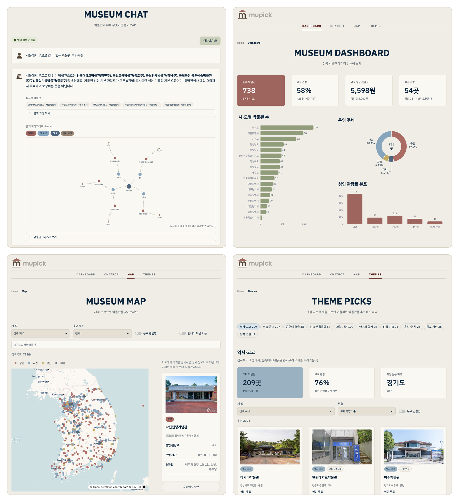
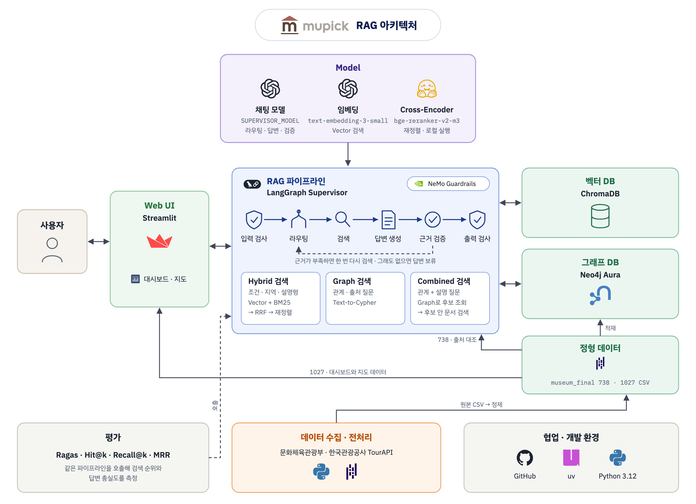

<p align="center">
  
</p>

<h1 align="center">박물관 RAG 챗봇</h1>

<p align="center">
  질문 유형에 따라 벡터 검색, 그래프 관계 추론 또는 두 방식을 결합해<br>
  근거 있는 답변을 제공하는 박물관·미술관 GraphRAG 시스템
</p>

<p align="center">
  🚀 <a href="https://mle-01-p3-team1git-bbejly367hmdj9ornyfbpq.streamlit.app/"><b>mupick</b></a> ·
  📊 <a href="https://docs.google.com/spreadsheets/d/1skL2_D_ndb_xmYK5BoVE9eKltxutdhhkg5_orGCgML0/edit?gid=1924971893#gid=1924971893">데이터 명세서</a> ·
  📈 <a href="docs/evaluation/README.md">평가 문서</a> ·
  🛠 <a href="docs/records/supervisor-retrieval-issues.md">문제 해결 기록</a> ·
  🗓 2026.11.12 ~ 11.16 (5일) · 👥 4명
</p>

<p align="center">
  "주차 되는 서울 어린이 박물관 알려줘", "월요일에도 여는 미술관 있어?" 같은 질문을 받으면 Supervisor가 질문 유형에 맞는 검색 경로를 고릅니다. 찾아온 근거로 답변을 만들고 검증한 뒤 <b>출처와 함께</b> 보여 줍니다. 근거가 부족하면 지어내지 않고 답변을 보류합니다.
</p>

<p align="center">
  
</p>

---

## 목차

1. [프로젝트 소개](#프로젝트-소개)
2. [주요 기능](#주요-기능)
3. [시스템 구조](#시스템-구조)
4. [기술 스택](#기술-스택)
5. [데이터](#데이터)
6. [빠른 시작](#빠른-시작)
7. [실행](#실행)
8. [평가](#평가)
9. [폴더 구조](#폴더-구조)
10. [팀 · 역할](#팀--역할)
11. [회고](#회고)
12. [문제 해결](#문제-해결)
13. [문서](#문서)

---

## 프로젝트 소개

박물관과 미술관은 역사, 문화, 예술, 지역 특성을 이해할 수 있는 공간이지만, 방문할 시설을 찾을 때 필요한 정보를 한 번에 확인하기는 쉽지 않습니다. 소개글, 위치, 관람료, 운영시간이 공공데이터, 관광정보 서비스, 개별 홈페이지에 흩어져 있기 때문입니다. 또 키워드 검색만으로는 관심 분야와 방문 조건을 함께 고려하거나 박물관 사이의 관계를 탐색하기 어렵습니다.

그래서 **자연어 의미 검색과 그래프 관계 탐색을 결합해** 박물관·미술관 정보를 쉽게 찾을 수 있는 시스템을 만들었습니다.

| 문제 | 현재의 불편함 | 해결 방향 |
|---|---|---|
| 정보 분산 | 홈페이지와 공공데이터를 각각 찾아봐야 함 | 시설 정보를 통합해 하나의 화면에서 검색 |
| 키워드 검색의 한계 | 정확한 박물관 이름이나 전시 분야를 모르면 검색이 어려움 | 소개글 임베딩을 통한 의미 기반 검색 |
| 복합 조건 검색의 어려움 | 지역, 관람료, 관심 분야를 함께 비교하기 어려움 | 구조화된 속성과 Vector 검색 결합 |
| 시설 간 관계 탐색 부족 | 같은 운영기관이나 같은 지역의 다른 시설을 찾기 번거로움 | Neo4j 관계 탐색 및 Multi-hop 검색 |
| 답변 신뢰성 문제 | 검색 결과의 출처가 불분명하거나 오래된 정보일 수 있음 | 원문 출처 표시, 근거 검증, 답변 보류 정책 |

## 주요 기능

| 기능 | 설명 |
|---|---|
| **Hybrid 검색** | Chroma 의미 검색과 BM25 키워드 검색(kiwipiepy 형태소 분석) 결과를 가중 RRF로 합치고, Cross-Encoder(`BAAI/bge-reranker-v2-m3`)로 다시 정렬합니다. |
| **Supervisor 라우팅** | 편의시설·개관 요일 조건, 지역+주제, 설명형, 관계·출처 질문을 구분해 Hybrid 또는 Graph 경로로 보냅니다. |
| **온톨로지 후보 필터** | "주차 가능", "월요일 개관" 같은 조건을 먼저 걸러 후보 시설을 줄인 뒤 검색합니다. |
| **Neo4j GraphRAG** | 기관·편의시설·주제·휴관 규칙을 그래프로 저장하고, 관계를 따라가야 하는 질문에 답합니다. Neo4j 계정을 설정하고 `--with-neo4j` 옵션을 켰을 때만 동작하며, 없어도 Hybrid 검색만으로 챗봇을 쓸 수 있습니다. |
| **답변 검증과 보류** | 근거와 답변이 맞는지 검증하고, 실패하면 한 번 다시 검색합니다. Graph 검색이 실패했다면 이때 Hybrid로 바꿔 찾습니다. 그래도 근거가 부족하면 답변을 보류하고 없는 조건을 안내합니다. |
| **입력·출력 가드레일** | NeMo Guardrails 기반으로 부적절한 질문과 답변을 차단합니다. |
| **Streamlit UI** | 챗봇, 대시보드, 지도, 지식그래프 시각화를 제공합니다. 지식그래프는 그래프 검색을 썼을 때만 보입니다. |

## 시스템 구조

<p align="center">
  
</p>

- 검색 경로: 편의시설·개관 요일 조건, 지역+주제, 설명형 질문은 Hybrid 검색으로, 관계·출처 질문은 Neo4j Graph 검색으로 보냅니다. "신안갯벌박물관과 같은 기관이 운영하는 시설 중 화석과 광물을 전시하는 곳은?"처럼 관계와 설명이 함께 필요한 질문은 Combined 검색으로 보내, Graph로 후보 시설을 찾은 뒤 그 안에서 문서를 검색합니다.
- 상세 흐름: [Supervisor 연결](docs/architecture/supervisor-integration.md), [구조 이미지 안내](docs/architecture/images/README.md)
- 설계 이유: [기술 결정 기록](docs/decisions/README.md)

## 기술 스택

| 영역 | 사용 기술 |
|---|---|
| 언어·환경 | Python 3.12, [uv](https://docs.astral.sh/uv/) 0.12 |
| LLM | OpenAI `gpt-6-luna` (Supervisor·답변·검증·RAGAS 채점) |
| 임베딩 | OpenAI `text-embedding-3-small` (1536차원) |
| 재정렬 | `BAAI/bge-reranker-v2-m3` · sentence-transformers 6.2.0 |
| 오케스트레이션 | LangChain 1.4.7 · LangGraph 1.2.18 · langchain-openai 1.7.3 |
| 벡터 검색 | ChromaDB 1.5.9 · langchain-chroma 1.1.0 |
| 키워드 검색 | rank-bm25 0.2.2 · kiwipiepy 0.24.1 (한국어 형태소 분석) |
| 지식그래프 | Neo4j Aura · neo4j Python driver 6.4.1 |
| 안전 | NeMo Guardrails 0.24.1 |
| 평가 | RAGAS 0.4.3, 자체 검색 순위 지표(Hit@k, Recall@k, MRR) |
| 데이터·UI | pandas 2.3.3 · Streamlit 1.67.0 · Plotly 7.1.0 |

전체 의존성과 정확한 버전은 [pyproject.toml](pyproject.toml)과 [uv.lock](uv.lock)에 있습니다.

## 데이터

> 📊 컬럼별 정의, 출처, 처리 규칙은 [데이터 명세서](https://docs.google.com/spreadsheets/d/1skL2_D_ndb_xmYK5BoVE9eKltxutdhhkg5_orGCgML0/edit?gid=1924971893#gid=1924971893)에 정리했습니다.

| 항목 | 내용 |
|---|---|
| 출처 | 전국 박물관·미술관 기본 데이터(공공데이터), 한국관광공사 TourAPI 개요, 웹 조사 |
| 규모 | 원본 기본 데이터 1,070행 + TourAPI 493행 → 통합 후 **738곳** (17개 시·도) |
| 출처 구성 | 기본+TourAPI 266곳 · 기본 데이터만 236곳 · TourAPI만 214곳 · 웹 조사 포함 22곳 |
| 주요 컬럼 | `museum_id`, `name`, `sido`·`sigungu`, `adult_fee`·`youth_fee`·`child_fee`, `weekday_open`·`weekday_close`, `closure_rule_raw`(휴관 규칙), `amenities_raw`(편의시설), `text`(통합 소개글) |
| 기준 파일 | [`data/processed/museum_final_738.csv`](data/processed/museum_final_738.csv): Chroma·Neo4j 적재와 답변 출처 연결의 기준 |

**전처리 요약**
- **시설 통합**: 출처별로 나뉜 행을 `museum_id` 하나로 묶고, 출처마다 다른 소개글을 합쳐 `text`를 만들었습니다. 합치면서 겹친 문장은 지웠습니다.
- **지역명 통일(도메인 사전)**: 원본에는 시·도 표기가 20종 섞여 있어서 [region_aliases.py](src/region_aliases.py)로 통일합니다. 예를 들어 `전라북도` / `전북` / `전라북` → `전북특별자치도`, `세종특별시` → `세종특별자치시`로 바꿉니다. 원본 CSV는 그대로 두고 검색과 화면 표시 단계에서만 바꿉니다.
- **이상치·결측**: 관람료 10만 원 이상은 입력 오류로 보고 결측 처리하고, 편의시설 값 중 `없음`·`#NAME?`은 제거합니다.
- **Streamlit 화면 데이터**: `museum_final_1027.csv`는 같은 시설이 출처별로 여러 행 들어 있는 파일입니다. 화면에서는 `museum_id` 기준으로 중복을 지워 **같은 738곳**을 보여 줍니다.

## 빠른 시작

### 준비물

- Python **3.12**, [uv](https://docs.astral.sh/uv/getting-started/installation/)
- OpenAI API 키: [platform.openai.com/api-keys](https://platform.openai.com/api-keys)에서 발급합니다. 사용할 모델의 접근 권한이 필요하고, 질문·근거·가드레일 검사가 API로 전송되어 사용료가 발생합니다.
- (선택) Neo4j를 쓰려면 연결 가능한 Aura DB와 계정 정보가 필요합니다. Hybrid만 쓸 때는 없어도 됩니다.

> 아래 명령은 Windows · macOS · Linux에서 똑같이 쓸 수 있습니다. 운영체제마다 다른 줄만 따로 적었습니다.

### 1) 내려받기와 설치

```bash
git clone https://github.com/encore-ai-campus/mle-01-p3-team1.git
cd mle-01-p3-team1
uv sync
```

루트 의존성에 실습용 패키지도 들어 있어 처음 설치는 오래 걸릴 수 있습니다.

### 2) 환경 변수

```bash
cp .env.example .env              # Windows PowerShell: Copy-Item .env.example .env
```

`.env`를 열어 아래 값을 채웁니다.

```dotenv
OPENAI_API_KEY=발급받은_키
SUPERVISOR_MODEL=gpt-6-luna
MUSEUM_QUERY_ANALYSIS_ENABLED=false

# Neo4j를 쓸 때만
NEO4J_URI=...
NEO4J_USER=...
NEO4J_PASSWORD=...
NEO4J_DATABASE=...
```

- `gpt-6-luna`는 팀에서 사용한 예시 모델로, 계정에서 쓸 수 있는 구조화 출력 모델로 바꾸면 됩니다. (실행할 때 `--model`로 지정해도 가능)
- `OPENAI_CHAT_MODEL`, `RAGAS_JUDGE_MODEL`, `GUARDRAILS_MODEL`은 필요할 때만 지정합니다.
- `.env`는 공유하거나 Git에 올리지 않습니다. 저장소에는 빈 양식인 [.env.example](.env.example)만 들어 있습니다.

### 3) Cross-Encoder 모델 준비 (최초 1회)

```bash
uv run python -m src.hybrid.prepare_models
```

처음 실행할 때 모델 파일을 내려받으므로 시간과 저장 공간이 필요합니다. 이미 받아 둔 모델은 다시 받지 않고 그대로 씁니다.

### 4) 벡터 DB 확인

Chroma DB(`data/vector_db/museum_chroma/`, 738건)는 저장소에 포함되어 있어 **클론 후 바로 쓸 수 있습니다**. 데이터를 바꿨거나 DB가 깨졌을 때는 아래 명령 한 줄로 다시 만듭니다. 738건 임베딩에 **약 10초** 걸립니다.

```bash
uv run python scripts/build_vector_db.py --force
```

`--force`는 기존 컬렉션을 지우고 새로 만듭니다. 평가나 챗봇이 DB를 쓰는 중에는 실행하지 마세요. 단계별로 확인하며 만들고 싶다면 [벡터 DB 구축 노트북](notebooks/README.md)을 쓰면 됩니다.

> 다른 터미널에서 평가를 돌리고 있다면, 그 평가가 끝난 뒤에 같은 `.venv`를 설치·동기화 해야 합니다.

## 실행

### Streamlit UI

배포된 서비스는 **[mupick 바로가기](https://mle-01-p3-team1git-bbejly367hmdj9ornyfbpq.streamlit.app/)** 에서 바로 써 볼 수 있습니다 (Streamlit Community Cloud, `main` 브랜치가 바뀌면 자동 반영). 로컬에서 실행하려면:

```bash
uv run streamlit run src/service/app.py
```

브라우저에서 http://localhost:8501 이 열립니다. 챗봇 탭의 박물관 질문은 Supervisor가 답하고, 가드레일은 화면에서 한 번만 돕니다. 자세한 내용은 [service 안내](src/service/README.md)를 참고하세요.

### 터미널 챗봇

Hybrid + Supervisor + 입력·출력 가드레일:

```bash
uv run python -m src.agent.supervisor.run --team-hybrid --interactive --timings --model gpt-6-luna
```

Neo4j Graph 경로까지 함께 쓰려면 `--with-neo4j`를 붙입니다.

```bash
uv run python -m src.agent.supervisor.run --team-hybrid --with-neo4j --interactive --timings --model gpt-6-luna
```

| 옵션 | 설명 |
|---|---|
| `--interactive` | 질문을 계속 입력하고 `q`로 종료합니다. 같은 프로세스에서 모델을 재사용합니다. |
| `--question "질문"` | 질문 하나만 실행합니다. |
| `--with-neo4j` | Supervisor에 Graph 검색을 연결합니다. 없으면 Graph 경로를 쓰지 않습니다. |
| `--timings` | 단계별 소요 시간을 출력합니다. |

출력에서 `status`, `trajectory`, 소요 시간을 확인할 수 있습니다. 가드레일에 막히거나 검사 중 오류가 나면 `status: blocked`로 표시됩니다.

기본 설정에서는 검색 전 LLM 질문 분석이 꺼져 있습니다. 규칙 기반 지역 필터와 온톨로지 후보 필터는 이와 별개로 적용될 수 있습니다. 지역·요금 조건의 검색 품질을 비교하려면 `.env`에 `MUSEUM_QUERY_ANALYSIS_ENABLED=true`를 설정하면 됩니다.

## 평가

평가셋의 정답 라벨은 아직 사람 검수 전 초안이라 **모든 점수는 잠정치**입니다. 평가셋 구성과 정답을 정한 방법은 [평가 안내](evaluations/README.md)에 있습니다.

**최신: Supervisor 전체 흐름** (2026-11-15, v2 222문항 · 답변 가능 205 / 답변 불가 17, top-k 5) · [결과 보고서](outputs/evaluation/hybrid_ragas/run_20261115_182859_439081Z/summary.md)

| Hit@1 | Hit@5 | MRR@10 | Faithfulness | Context Recall | Context Precision | 검증 통과율 |
|---|---|---|---|---|---|---|
| 0.956 | 0.981 | 0.968 | 0.933 | 0.906 | 0.923 | 0.895 |

**기준선** (2026-11-13, 흐름 변경 이전) · [기준선 보고서](evaluations/reports/baseline_2026-11-13/README.md)

| 평가 | 평가셋 | 핵심 결과 | 보고서 |
|---|---|---|---|
| Hybrid + Cross-Encoder | v1 150문항 | Hit@1 0.972 · Recall@5 0.986 · Faithfulness 0.950 | [요약](evaluations/reports/baseline_2026-11-13/hybrid_ragas/run_20261113_124252_summary.md) |
| Neo4j GraphRAG | 10문항 | Faithfulness 0.978 · Context Recall 0.850 | [4차 보고서](evaluations/reports/baseline_2026-11-13/neo4j_multihop_ragas/run_20261113_170150/report.md) |
| Vector 검색 순위 | 30문항 | Hit@1 0.708 · Hit@5 0.792 · MRR@10 0.755 | [보고서](evaluations/reports/baseline_2026-11-13/vector_db/20261113_174527/report.md) |
| 가드레일 | 40문항 (공격 19 · 정상 21) | 공격 차단 19/19 · 정상 통과 21/21 · 미탐·오탐 0건 | [보고서](evaluations/reports/guardrails/가드레일_평가_v1_결과_20261113_2134.md) |

### 평가·개선 문서

| 문서 | 내용 |
|---|---|
| [평가 문서 색인](docs/evaluation/README.md) | 지표 설명, 이어서 실행하는 방법 |
| [Hybrid RAG 통합 평가](docs/evaluation/hybrid-ragas.md) | Vector·BM25·Hybrid·Supervisor 경로 비교 평가 방법 |
| [LangGraph RAGAS 평가](docs/evaluation/langgraph-ragas.md) | Neo4j GraphRAG 평가 방법 |
| [Vector DB 평가셋](docs/evaluation/vector-db.md) | 검색 순위 평가셋 구성 |
| [평가 결과 이력](evaluations/reports/README.md) | 보관한 평가 보고서 목록 |
| [Supervisor 검색 문제와 해결 기록](docs/records/supervisor-retrieval-issues.md) | 증상 → 원인 → 코드 변경 → 실측 (디버깅 기록) |
| [Neo4j Context Recall 분석](docs/records/neo4j-context-recall-analysis.md) | 평가 전후 변화와 문항별 실패 원인 |
| [평가 후 Supervisor–Neo4j 점검](docs/records/post-eval-supervisor-neo4j.md) | 요금·출처 문제와 개선 검토 |
| [Neo4j 적재 보고서](docs/records/neo4j-load-report.md) | 그래프 적재 이력, DB 명세, multi-hop 경로 검증 |

### 평가 실행

평가는 OpenAI API를 사용합니다. 아래 명령은 각각 독립된 평가라서 동시에 돌릴 필요가 없습니다.

```bash
# Supervisor 전체 흐름(자동 라우팅 + 후보 필터 + Neo4j), v2 평가셋 — Neo4j 설정 필요
uv run python -m src.evaluation.hybrid.ragas_eval --modes supervisor_full --top-k 5

# Hybrid + Cross-Encoder, v2 평가셋
uv run python -m src.evaluation.hybrid.ragas_eval --modes hybrid_rerank --top-k 5

# Neo4j GraphRAG, 10문항 — Neo4j 설정 필요
uv run python -m src.evaluation.langgraph.ragas_eval --evalset evaluations/datasets/neo4j/Neo4j_multihop_core10_draft.csv --top-k 5 --batch-size 8

# Chroma 검색 순위, 30문항 — 기존 결과를 덮어쓰지 않도록 실행마다 폴더 이름을 바꿔 주세요
uv run python -m src.evaluation.vector_db.evaluate --output outputs/evaluation/vector_db/run_<날짜_시각>
```

결과는 `outputs/evaluation/` 아래 실행별 폴더(`hybrid_ragas/`, `neo4j_multihop_ragas/`, `vector_db/`)에 저장됩니다. 결과를 쓰고 있는 폴더는 옮기거나 지우지 않아야 합니다.

## 폴더 구조

```
mle-01-p3-team1/
├── src/
│   ├── agent/
│   │   └── supervisor/        # 라우팅·검증·재검색·출처 연결 (connect.py 진입점, run.py CLI)
│   ├── hybrid/                # Vector + BM25, RRF, Cross-Encoder (prepare_models.py 모델 준비)
│   ├── guardrails/            # 입력·출력 안전 검사
│   ├── evaluation/            # 평가 실행 코드 (hybrid · langgraph · vector_db)
│   ├── data_pipeline/         # 데이터 적재·검증 (Neo4j 온톨로지 포함)
│   ├── service/               # Streamlit UI (app.py, ui/)와 Vector 검색 서비스
│   └── region_aliases.py      # 시·도 표기 통일 사전
├── data/
│   ├── raw/                   # 원본 CSV (기본 데이터 1,070행, TourAPI 493행)
│   ├── processed/             # 정제 CSV (museum_final_738.csv)
│   └── vector_db/             # Chroma DB (museum_documents, 738건)
├── evaluations/               # 평가셋, 보관용 평가 보고서
├── outputs/                   # 로컬 평가·실행 결과
├── notebooks/                 # 벡터 DB 구축 노트북
├── scripts/                   # build_vector_db.py(벡터 DB 재구축), 설치 스크립트
├── docs/                      # 구조, 설계 결정, 평가, 작업 기록, 화면 이미지
└── tests/                     # 단위·통합 테스트
```

폴더마다 README가 있습니다: [src](src/README.md) · [data](data/README.md) · [evaluations](evaluations/README.md) · [outputs](outputs/README.md) · [notebooks](notebooks/README.md) · [scripts](scripts/README.md) · [docs](docs/README.md) · [tests](tests/README.md)

## 팀 · 역할

| 이름 | 역할 | 담당 영역 | GitHub |
|---|---|---|---|
| 홍기표 | 팀장, 발표 | 일정관리, 발표, 통합, 데이터 전처리, Supervisor | [gipyohong](https://github.com/gipyohong) |
| 엄가현 | Streamlit, 가드레일 | 데이터 수집, Streamlit UI, 시각화 및 배포, 문서 작성, 가드레일 구축 및 평가 | [Gahyun0121](https://github.com/Gahyun0121) |
| 이건호 | RAG | 청킹, 임베딩, 에이전트 구축, Langfuse, Hybrid 검색 | [geeeeeonho](https://github.com/geeeeeonho) |
| 김동석 | Neo4j | Neo4j 적재, 디버깅 | [seventy4-git](https://github.com/seventy4-git) |

## 회고

### 홍기표

<!-- TODO: 회고 내용 채우기 -->

- **Keep**:
- **Problem**:
- **Try**:

### 엄가현

- **Keep**: Streamlit UI와 NeMo Guardrails를 구현하고, 사용자 입장에서 화면과 대화 흐름을 개선했다. 별도 평가셋으로 가드레일 동작도 확인했다.
- **Problem**: UI와 검색 엔진의 연결을 늦게 확인해 응답 지연과 답변 보류 문제가 한꺼번에 드러났다. 팀 결정사항을 기록하지 않아 작업이 충돌할 뻔했다.
- **Try**: 다음 프로젝트에서는 초기에 UI와 검색 엔진을 연결해 응답 속도와 대화 흐름을 점검하겠다. 팀에서 합의한 내용은 바로 기록하고 공유하겠다.

### 이건호

- **Keep**: Vector DB와 BM25를 결합한 Hybrid RAG를 구현하고 일관성 유지를 하려 했다. Langfuse를 통해 실행 과정을 관측할 수 있는 환경을 구축했다.
- **Problem**: 검색 단계가 복잡해지면서 문제 원인 파악이 어려웠고, 관측 환경을 프로젝트 후반에 도입한 점이 아쉬웠다.
- **Try**: 다음 프로젝트에서는 초기부터 관측 환경을 구축하고, 검색 단계별 성능과 후보 순위 변화를 분석하며 전략적으로 개선하겠다.

### 김동석

- **Keep**: 사전 검증 로직과 50개 단위 트랜잭션 분할을 통해 대량의 박물관 데이터를 안정적이고 무결하게 적재했다.
- **Problem**: 복잡한 중첩 JSON 구조와 다수 출처 메타데이터 간의 관계 정합성을 유지하고 속성 타입을 관리하는 것이 다소 까다로웠다.
- **Try**: 다음 프로젝트에서는 온톨로지 스키마 제약조건과 다중 홉 경로 자동 검증 스크립트를 고도화해 데이터 정합성 관리를 체계화하겠다.

## 문제 해결

| 증상 | 확인할 것 |
|---|---|
| 모델이 없다는 오류 | 모델 준비 명령(`uv run python -m src.hybrid.prepare_models`)을 다시 실행 |
| Chroma 오류 | 컬렉션 `museum_documents`가 있는지 확인하고, 없거나 깨졌으면 `uv run python scripts/build_vector_db.py --force`로 다시 구축 |
| Neo4j 연결 오류 | `.env`의 `NEO4J_*` 값과 Aura 인스턴스 상태 |
| 답변이 차단됨 | 가드레일 검사가 실패하면 안전을 위해 답변을 막습니다. |

> LangGraph의 중간 스트림에는 가드레일 검사 전 초안이 섞일 수 있습니다. 사용자 화면에는 `invoke()`의 최종 결과만 보여 주세요.

## 문서

| 문서 | 내용 |
|---|---|
| [폴더 구조](docs/architecture/folder-structure.md) | 파일별 역할과 주요 실행 명령 |
| [Supervisor 연결](docs/architecture/supervisor-integration.md) | 라우팅 우선순위, Hybrid·Neo4j·가드레일 연결 |
| [온톨로지 v2](docs/architecture/ontology-v2.md) | Neo4j 스키마(기관·편의시설·주제·휴관 규칙) |
| [기술 결정](docs/decisions/README.md) | 설계 이유 |
| [작업 기록](docs/records/README.md) | 정리·적재 기록, 검색 문제 해결 기록 |
| [평가 문서](docs/evaluation/README.md) | 지표 설명, 이어서 실행하는 방법 |
| [전체 문서 색인](docs/README.md) | 운영, 기록, 계획 문서 |
