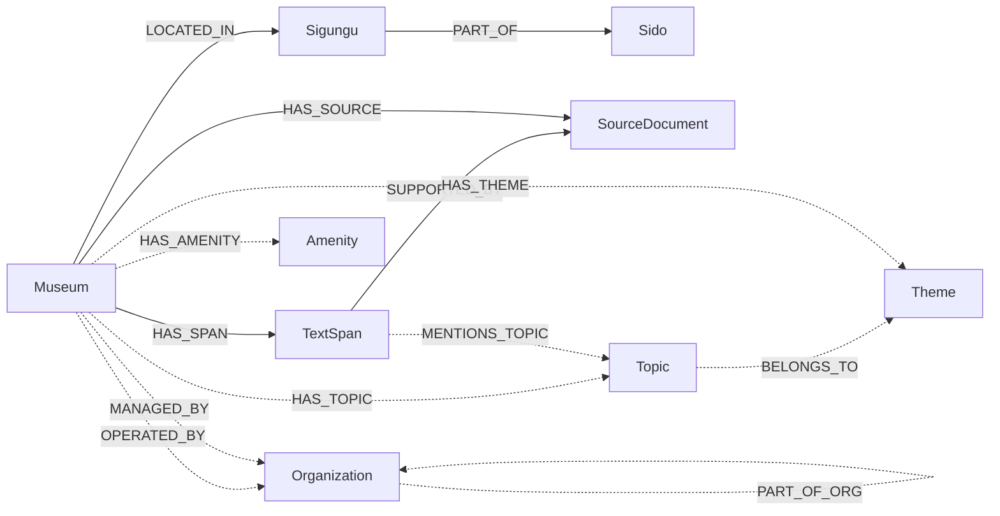

# 박물관 GraphRAG 온톨로지 v2

기존 Neo4j 그래프에 **노드와 관계를 추가만** 하는 확장안입니다. `museum_final_738.csv`는 읽기만 하고, 기존 `Museum`, `Sido`, `Sigungu`, `SourceDocument`, `TextSpan`과 기존 관계는 바꾸지 않습니다.

- 생성기: [`src/data_pipeline/neo4j/ontology_v2/`](../../src/data_pipeline/neo4j/ontology_v2)
- 실행 안내: [ontology_v2 README](../../src/data_pipeline/neo4j/ontology_v2/README.md)

## 설계 원칙

| 원칙 | 적용 |
|---|---|
| 원본 불변 | CSV는 읽기만 합니다. 기존 노드의 속성은 덮어쓰지 않고 새 속성만 추가합니다. |
| 지역 통합은 코드에서 | `Sido`/`Sigungu` 병합이나 `PART_OF` 변경은 하지 않습니다. 별칭 처리는 질의 시점 코드([`src/region_aliases.py`](../../src/region_aliases.py), `neo4j_text2cypher.py`)가 담당합니다. |
| 되돌릴 수 있음 | 새로 만든 노드와 관계에는 모두 `ontology_version: "v2"`가 붙습니다. `99_rollback.cypher`는 v2 표시가 있는 것과 목록에 적힌 Museum 속성만 지웁니다. |
| 근거와 확신도 | 규칙으로 만든 관계에는 `method`와 `verification_status`를 기록합니다. 주제 관계는 근거가 된 `TextSpan`과 연결합니다. |

## 스키마



실선은 기존 구조, 점선은 v2에서 추가하는 구조입니다.

## 추가 요소

| 요소 | 원천 | 방법 | 신뢰 표시 | 수량 |
|---|---|---|---|---|
| `Museum.facility_type` | `name` | 이름 끝말 우선, 키워드 보조 | `facility_type_method` | 738 |
| `Organization` | `operator_name`, `manager_name` | 이름 규칙 정규화 | `verification_status: UNVERIFIED` | 782 |
| `OPERATED_BY` | `operator_name` | 원문 그대로 연결 | `SOURCE_RECORDED`, `self_named` | 737 |
| `MANAGED_BY` | `manager_name` | 원문 그대로 연결 | `UNVERIFIED`, `same_as_operator` | 736 |
| `PART_OF_ORG` | 기관명 구조 | 부서·소속기관을 상위기관에 연결 | `UNVERIFIED` | 71 |
| `Amenity` / `HAS_AMENITY` | `amenities_raw` | 24종 통제 어휘 사전 | `raw_tokens` 보존 | 24 / 596 |
| `Theme` / `Topic` | 설계 분류표 | 10개 Theme, 36개 Topic | — | 10 / 36 |
| `HAS_TOPIC` | `TextSpan.text`, `name` | 키워드: 이름에 있거나 본문 2회 이상 | `confidence`, `evidence_span_ids`, `UNVERIFIED` | 633 |
| `MENTIONS_TOPIC` | `TextSpan` | 근거 문장과 Topic 연결 | `method` | 1,572 |
| `HAS_THEME` | Topic, 시설 유형 | `via_topic` / `via_facility_type` | — | 실행 후 집계 |
| `Museum.activity_types` | `TextSpan.text` | 체험·교육·공연·해설 키워드 | `activity_evidence_span_ids` | 325 |
| `Museum.closure_*` | `closure_rule_raw` | 휴관 규칙 파싱 | `closure_parse_status` | 738 |

### Organization

- 운영기관(`OPERATED_BY`)과 관리기관(`MANAGED_BY`)은 **별도 관계**로 둡니다. 두 컬럼이 같은 기관이면 `same_as_operator: true`로 표시합니다.
- 정규화 규칙:
  - `경기도 구리시청`과 `경기도 구리시`처럼 '청'이 붙고 안 붙은 표기는 같은 지자체로 합칩니다.
  - `(재)`, `㈜`, `주식회사` 같은 접두사와 접미사는 식별 키에서 뺍니다.
  - 표기가 다른 같은 기관은 수동 별칭 사전 `ORG_ALIASES`로 묶습니다.
- 부서는 상위기관과 합치지 않고 별도 노드로 만든 뒤 `PART_OF_ORG`로 연결합니다. 예: `경기도 부천시 문화예술과 문화종무팀` → `경기도 부천시`.
- `농업기술센터`, `교육청`, `박물관`처럼 일반명사인 소속기관은 상위기관 이름을 붙여 식별합니다. 예: `경기도 고양시 농업기술센터`.
- 운영기관이 시설 자기 자신인 경우가 336건이고, `self_named: true`로 표시합니다.
- 기관명이 아닌 값(`사립`)은 건너뜁니다.
- `org_type`은 이름 규칙으로 붙인 추정치입니다. 분류는 문화시설, 지방자치단체, 재단·비영리법인, 공공기관, 대학·학교법인, 기업, 국립기관, 중앙행정기관, 종교단체, 개인, 기타입니다.

### Theme / Topic / activity

- Theme은 설계안의 9개에 **종교**를 더한 10개입니다.
- 설계안 예시에서는 6·25전쟁을 '역사' 아래에 두었지만, 분류표에 맞춰 **전쟁·평화** 아래에 두었습니다.
- 체험·교육·공연·해설은 Theme이 아니라 `Museum.activity_types` 속성으로 분리했습니다.
- `HAS_TOPIC.confidence`:
  - `high`: 시설 이름에 키워드가 있음
  - `medium`: 본문에서 3회 이상
  - `low`: 본문에서 2회
- 근거 경로: `Museum -HAS_SPAN-> TextSpan -MENTIONS_TOPIC-> Topic`, 그리고 `TextSpan -SUPPORTED_BY-> SourceDocument`.

## 이번에 넣지 않은 것

| 항목 | 이유 |
|---|---|
| 지역 정규화 (Sido 병합, `ALIAS_OF`, `canonical_*`) | 질의 시점 코드에서 이미 처리하고 있어 DB에 중복으로 넣지 않습니다. |
| AdmissionRule 노드 | 요금은 이미 `adult_fee`, `youth_fee`, `child_fee`, `adult_fee_status`, `fee_notes` 속성으로 있습니다. 예외 요금을 노드로 만들 필요가 생기면 추가합니다. |
| OpeningRule 노드 | 속성(`closure_*`)으로 시작합니다. 휴관 규칙끼리 비교하는 다중 홉 질의가 필요해지면 노드로 옮깁니다. |
| Program | CSV에 원천 컬럼이 없고 환각 위험이 커서, 검증 절차를 마련한 뒤 추가합니다. |

## 적재와 코드 반영 (2026-11-14)

- **적재:** Aura에 적재했고, `apply_cypher --verify-only`의 13개 항목이 모두 기대값과 같습니다. 기존 그래프 개수(738 / 20 / 199 / 1027 / 3260)도 그대로입니다.
- **Text2Cypher** (`src/agent/neo4j_text2cypher.py`):
  - 허용 라벨과 관계에 v2를 추가했습니다.
  - 관계 검증이 `[r:TYPE]`, `[:A|B]` 형태도 검사하도록 고쳤습니다. 이전에는 이 두 형태가 검사 없이 통과했습니다.
  - 스키마 프롬프트에 v2 구조와 아래 주의 규칙을 넣었습니다.
  - v2 반환 필드를 근거로 넘기도록 했습니다.
- **고정 쿼리:** "○○과 같은 기관이 운영/관리하는 시설" 질문은 `same_operator` / `same_manager` 고정 쿼리로 LLM 없이 처리합니다. 결과가 비어 있으면 그대로 답으로 쓰고 LLM 재생성을 하지 않습니다.
- **Supervisor 라우터 프롬프트:** v2 스키마를 알려 주고, 기관으로 연결되는 질문은 Graph로 보내도록 했습니다.
- **적재 후 실제 질문으로 점검하며 고친 것:** 편의시설 근거 인정, 기록이 없는 조건 처리, 기관 질문의 기준 시설(anchor) 근거는 [문제 해결 기록](../records/supervisor-retrieval-issues.md#온톨로지-v2-연결-후-근거-전달-점검-2026-11-14)에 있습니다.
- **Hybrid 후보 필터와의 관계:** v2와 같은 규칙으로 CSV에서 계산한 조회표를 씁니다. 이유와 일치 점검 결과는 [온톨로지 후보 필터](../decisions/ontology-filter-routing.md)에 있습니다.

## 답변 시 주의 규칙 (Text2Cypher 프롬프트에 반영됨)

- `HAS_AMENITY`가 없다는 것은 "기록 없음"이지 "시설 없음"이 아닙니다. 편의시설 데이터는 292개 시설에만 있습니다.
- `Amenity`는 있는지 여부만 나타냅니다. "장애인 주차면 몇 면"처럼 수량을 묻는 질문에는 답할 수 없습니다.
- `closure_*`는 정적인 규칙입니다. "오늘 임시 휴관하는지" 같은 실시간 질문에는 답할 수 없습니다.
- `MANAGED_BY`, `PART_OF_ORG`, `HAS_TOPIC`은 `UNVERIFIED`이므로, 답변에 쓸 때 근거 span이나 원문 기관명을 함께 제시합니다.

## 평가

- 기존 평가셋(LangGraph 30문항, Neo4j multihop 10문항)은 수정하지 않습니다. v2 적재 후 **회귀 확인용**으로 그대로 다시 돌립니다.
- 기존 질문은 새 노드를 쓰지 않으므로, 기관·주제·편의시설·휴관일 질문으로 별도 평가셋을 만들어야 개선 효과를 측정할 수 있습니다.

## v2 질의 예시

```cypher
// 같은 기초지자체가 운영하는 다른 시설
MATCH (a:Museum {name: "창녕박물관"})-[:OPERATED_BY]->(o:Organization)<-[:OPERATED_BY]-(b:Museum)
WHERE a <> b RETURN o.name, collect(b.name);

// 같은 시군구에서 6·25전쟁을 다루는 시설과 근거 문장
MATCH (a:Museum {name: "박진전쟁기념관"})-[:LOCATED_IN]->(g:Sigungu)<-[:LOCATED_IN]-(b:Museum)
MATCH (b)-[:HAS_SPAN]->(s:TextSpan)-[:MENTIONS_TOPIC]->(:Topic {name: "6·25전쟁"})
RETURN b.name, s.text;

// 수유실이 있고 월요일에도 여는 미술관
MATCH (m:Museum {facility_type: "미술관"})-[:HAS_AMENITY]->(:Amenity {name: "수유실"})
WHERE NOT "월" IN m.closure_weekdays AND m.closure_parse_status = "parsed"
RETURN m.name, m.sido, m.sigungu;
```
