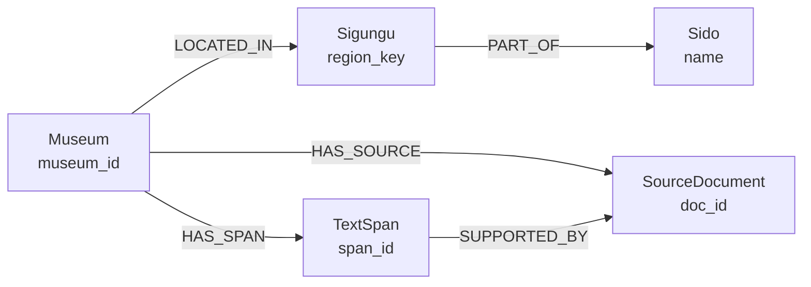

# Neo4j 박물관 적재 보고서

**실행일:** 2026-11-12 (KST)  
**입력:** `data/processed/museum_final_738.csv`
**입력 SHA-256:** `c40d1f2d794bfd6415c763fe487d639a634c0cba9313984ec4b0b67a4ea6cb45`  
**환경:** Python 3.12.13, Neo4j Python Driver 6.4.1, 대상 DB `878d9ed6`  
**상태:** 적재 후 Neo4j에서 읽은 수가 입력 기준과 일치함. 동일 CSV를 재실행한 뒤에도 수가 유지됨.

| 대상 | CSV에서 예상 | Neo4j 읽기 결과 |
|---|---:|---:|
| 박물관 `Museum` | 738 | 738 |
| 출처 `SourceDocument` | 1,027 | 1,027 |
| 본문 구간 `TextSpan` | 3,260 | 3,260 |
| `Museum`–`SourceDocument` | 1,027 | 1,027 |
| `Museum`–`TextSpan` | 3,260 | 3,260 |
| `TextSpan`–`SourceDocument` | 3,270 | 3,270 |
| 시도 `Sido` | 20 | 20 |
| 시군구 `Sigungu` (시도+시군구 조합) | 199 | 199 |
| `Museum`–`Sigungu` | 738 | 738 |
| `Sigungu`–`Sido` | 199 | 199 |

적재는 박물관 50개씩 15개 트랜잭션으로 실행했습니다. 입력 전체의 ID 중복, JSON 구조, 본문 길이·SHA-256, 좌표, 근거 구간과 출처 참조를 쓰기 전에 검증했습니다. Python 3.12 테스트 10개가 통과했습니다. 정확한 기계 판독 결과는 로컬 `outputs/neo4j/load_result.json`을 확인합니다. 실행 결과 디렉터리는 Git에서 제외되어 이 보고서만 clone하면 JSON은 내려받지 않습니다.

## 적재된 박물관 서브그래프 온톨로지

이 절은 `museum_final_738.csv`에서 적재한 **Neo4j 속성 그래프의 개체·관계 모델**을 기술합니다. DB 전체에 다른 데이터가 있는지까지 판정하는 온톨로지 목록은 아닙니다. 위 표의 노드·관계 수는 해당 CSV의 ID 집합으로 DB를 읽어 검증한 값입니다.

| 노드 유형 | 고유 식별 키 | 주요 속성과 의미 | 검증 수 |
|---|---|---|---:|
| `Museum` | `museum_id` | 박물관명, 주소·좌표, 운영·요금 정보, 합쳐진 설명 `text`, 품질·검토 상태. CSV의 나머지 열도 속성으로 보존 | 738 |
| `Sido` | `name` | 시도 이름. 광역 행정구역 | 20 |
| `Sigungu` | `region_key` | `[시도, 시군구]` 조합으로 만든 키, 시군구 이름과 시도 이름. 같은 시군구명이 여러 시도에 있어도 구별 | 199 |
| `SourceDocument` | `doc_id` | `source_type`, `source_file`, `source_locator`, `match_trust` 등 원문 출처 메타데이터. 원문 전체 텍스트는 이 노드에 없음 | 1,027 |
| `TextSpan` | `span_id` | 합쳐진 `Museum.text`의 `start`·`end` 위치와 해당 부분 문자열 `text`. ID는 박물관 ID와 구간 순서로 구성 | 3,260 |

| 방향 관계 | 의미 | 검증 수 |
|---|---|---:|
| `Museum` → `Sigungu` `LOCATED_IN` | 박물관의 행정구역 | 738 |
| `Sigungu` → `Sido` `PART_OF` | 시군구가 속한 시도 | 199 |
| `Museum` → `SourceDocument` `HAS_SOURCE` | 박물관 설명을 구성할 때 사용한 출처 | 1,027 |
| `Museum` → `TextSpan` `HAS_SPAN` | 박물관 설명에서 추적 가능한 근거 구간 | 3,260 |
| `TextSpan` → `SourceDocument` `SUPPORTED_BY` | 구간을 뒷받침하는 출처 문서. 한 구간에 둘 이상의 출처가 연결될 수 있음 | 3,270 |

다섯 식별 키에는 각각 유일성 제약을 생성했습니다. 관계의 1:1·1:N 카디널리티 자체는 DB 제약으로 강제하지 않습니다. `SUPPORTED_BY`는 **설명 텍스트 구간의 출처**를 뜻하며, 박물관의 요금·운영시간 등 모든 속성이 해당 문서로 독립 검증됐다는 의미는 아닙니다. 박물관 간 유사성, 전시 주제, 인물·사건 같은 의미 관계는 이 CSV에서 추출하거나 적재하지 않았습니다.

이 그래프는 2단계 GraphRAG의 **Cypher 확장 대상**입니다. 1차 벡터 앵커 검색에 사용할 임베딩과 벡터 인덱스는 아직 없으므로, 현재 구조만으로는 2단계 하이브리드 검색 전체가 동작하지 않습니다.

## Multi-hop 경로 검증

**검증 시각:** 2026-11-12 11:54:20 KST

**방식:** `validate_multihop.py`로 Aura DB를 읽기 전용 조회. CSV의 박물관·출처·구간 ID 집합으로 범위를 제한하고, 적재 기본 수치와 아래 경로 수를 대조했습니다. 기계 판독 결과는 로컬 `outputs/neo4j/multihop_result.json`에 기록했습니다.

| 검사 경로·조건 | 기대 | DB 결과 |
|---|---:|---:|
| 2홉 `Museum → Sigungu → Sido` 경로; 박물관의 시도·시군구 속성과 일치 | 738 | 738 |
| 위 2홉 경로에 도달한 고유 박물관 | 738 | 738 |
| 2홉 `Museum → TextSpan → SourceDocument`; 동일 박물관의 `HAS_SOURCE` 출처인지 확인 | 3,270 | 3,270 |
| 3홉 `Sido ← Sigungu ← Museum → SourceDocument` | 1,027 | 1,027 |
| 4홉 `Sido ← Sigungu ← Museum → TextSpan → SourceDocument`; 동일 박물관의 출처인지 확인 | 3,270 | 3,270 |
| `TextSpan.text`와 `Museum.text[start:end]`가 다른 구간 | 0 | 0 |

**판정:** 적재된 박물관 서브그래프의 지역 및 텍스트 출처 경로는 현재 입력 데이터와 구조적으로 일치합니다. 이는 다중 홉 연결과 근거 위치를 검증한 결과이며, 출처 원문의 사실 정확성이나 LLM 답변 품질을 검증한 것은 아닙니다. 임베딩이 없어 1차 벡터 앵커 검색을 포함한 GraphRAG 전체 경로는 아직 검증할 수 없습니다.

## 데이터 품질과 후속 작업

- 655개 박물관에 `requires_manual_review=True`가 설정되어 있습니다. `adult_fee=0`인 428개 행의 상태는 `BASE_FEE_ZERO_CHECK_EXCEPTIONS`입니다. 검증 없이 무료로 안내하지 않아야 합니다.
- 출처 메타데이터가 가리키는 `museum_base_1070.csv`와 `web_research_verified.csv`는 현재 저장소에 없습니다. 이 출처의 원문 대조는 수행하지 못했습니다. 출처 메타데이터와 근거 구간은 그래프에 보존했습니다.
- 임베딩, 벡터 인덱스, 1차 벡터 검색은 아직 구성하지 않았습니다. 모델과 차원이 지정되지 않아 **알 수 없음**이며, 별도 벡터 작업에서 정한 후 2단계 GraphRAG 검색을 연결해야 합니다.
- 실행 전 DB의 같은 ID 데이터 수는 기록하지 않았으므로, 위 숫자를 모두 이번 실행에서 새로 생성한 수로 해석할 수 없습니다. 이 보고서는 현재 DB의 읽기 검증 결과를 나타냅니다.
