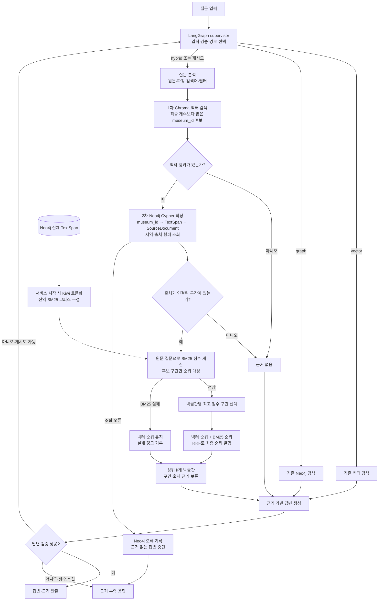

# Museum BM25 Hybrid Search Implementation Plan

> **For agentic workers:** REQUIRED SUB-SKILL: Use superpowers:subagent-driven-development (recommended) or superpowers:executing-plans to implement this plan task-by-task. Steps use checkbox (`- [ ]`) syntax for tracking.

**Goal:** Produce museum search results from Chroma vector anchors, Neo4j evidence expansion, and BM25 rank fusion.

**Architecture:** Search Chroma for more museum IDs than the final result count. Expand those IDs to sourced Neo4j text spans, score a stable graph-wide span corpus with BM25, and fuse museum-level vector and BM25 ranks. Preserve source provenance in the returned evidence.

**Tech Stack:** Python 3.12, Chroma, Neo4j Python driver, rank-bm25, kiwipiepy, LangGraph, unittest.

**Spec:** `docs/superpowers/specs/2026-11-13-museum-bm25-hybrid-design.md`

## 전체 서비스 로직

아래는 구현 목표인 서비스 흐름이다. 기존 `vector`·`graph` 경로는 유지하고, `hybrid` 경로와 답변 검증 실패 후 재시도 경로에 순차 검색 어댑터를 연결한다. BM25 인덱스는 요청마다 만들지 않고 서비스 시작 시 Neo4j의 전체 `TextSpan`으로 준비한다.

`Neo4j` 확장에 실패하면 출처가 없는 결과를 성공으로 반환하지 않는다. BM25 점수가 모두 0이면 벡터 순위를 유지한다. `RRF`에는 두 점수의 원값 대신 각 검색 결과의 순위를 사용한다. 최종 결과의 단위는 박물관이며, 답변 근거의 단위는 출처가 연결된 `TextSpan`이다.

## Global Constraints

- Python `>=3.12,<3.13`; use the existing declared dependencies.
- Chroma vector anchor retrieval must precede parameterized read-only Neo4j Cypher expansion.
- Keep Cypher in `src/agent/graph_db.py`; never interpolate question text or museum IDs into Cypher.
- Use the original question for BM25 and the existing expanded query for vector retrieval.
- Keep BM25 corpus statistics graph-wide and stable between requests; never fit BM25 on only the query's candidates.
- Preserve `museum_id`, `span_id`, and source IDs/URLs; do not invent evidence.
- The baseline suite has one unrelated existing failure: its Ragas 300-question CSV is absent from `origin/main`.

## Review Focus

- Empty or punctuation-only BM25 tokens leave the vector ranking intact; test in Task 2.
- Two spans with the same museum ID yield one museum rank with the highest sourced span; test in Task 2.
- Multiple `SUPPORTED_BY` edges do not duplicate a span and retain all source IDs; test in Task 1.
- A candidate museum missing from Neo4j is excluded or explicitly reported, never silently presented as sourced; test in Task 3.
- Neo4j or BM25 load errors are surfaced or produce an explicit documented fallback, never an unmarked success; test in Task 3.

---

### Task 1: Read-only graph expansion

**Files:** Create `src/agent/graph_db.py`; create `tests/test_hybrid_graph_db.py`.

**Interfaces:** `GraphMuseumStore(driver, database).load_span_corpus() -> list[Span]`; `.expand_museums(museum_ids: list[str]) -> list[ExpandedMuseum]`. `Span` carries `museum_id`, `span_id`, `text`; `ExpandedMuseum` carries museum identity, region, spans, and each span's source IDs and URLs.

- [ ] Write fake-driver tests for parameterized anchor IDs, read routing, deterministic order, repeated source edges, and empty IDs.
- [ ] Run `python -m unittest tests/test_hybrid_graph_db.py -v` and confirm the new tests fail for the missing module.
- [ ] Implement the Cypher constants and mapping in `src/agent/graph_db.py`, with one source-preserving record per span.
- [ ] Run the same tests and confirm they pass.
- [ ] Commit graph DB code and tests.

### Task 2: Stable Korean BM25 and rank fusion

**Files:** Create `src/agent/bm25_reranker.py`; create `tests/test_bm25_reranker.py`.

**Interfaces:** `MuseumBM25(spans: Sequence[Span], tokenize: Callable[[str], list[str]] | None = None)`; `.rank(question: str, candidates: Sequence[ExpandedMuseum]) -> dict[str, BM25Match]`. `fuse_ranks(vector_museum_ids, bm25_matches, *, final_k, rrf_constant=60, vector_weight=1.0, bm25_weight=1.0) -> list[RankedMuseum]`. A match carries the best sourced span and its raw score.

- [ ] Write tests for Korean token consistency, graph-wide corpus statistics, zero-token and zero-score fallback, maximum-per-museum aggregation, and RRF with stable ties.
- [ ] Run `python -m unittest tests/test_bm25_reranker.py -v` and confirm failure for the missing module.
- [ ] Implement tokenizer, `BM25Okapi` index, `span_id` mapping, and rank fusion. Index once and score the same corpus on each query.
- [ ] Run the same tests and confirm they pass.
- [ ] Commit BM25 code and tests.

### Task 3: Sequential hybrid adapter and LangGraph connection

**Files:** Create `src/agent/hybrid_search.py`; modify `src/agent/graph.py`, `src/agent/state.py`; create `tests/test_hybrid_search.py`; modify `tests/test_agent_graph.py`.

**Interfaces:** `HybridMuseumSearch(chroma_search, graph_store, bm25, query_analyzer).search(question: str, k: int) -> list[Evidence]`. `query_analyzer.analyze(question)` supplies the expanded vector query and metadata filters. `build_graph(..., hybrid_search: SearchFn | None = None)` uses the injected sequential adapter for the hybrid route when supplied; existing callers retain their behavior.

- [ ] Write fake-Chroma/graph tests for 4× candidate retrieval capped at 40, query analysis and metadata filters, vector → graph call order, sourced evidence, missing graph IDs, a span absent from the BM25 snapshot, invalid `k`, and a marked BM25 failure fallback. Add LangGraph injection test.
- [ ] Run the new and changed tests and confirm they fail for the missing adapter.
- [ ] Implement the adapter; keep `score` as the final fused score and raw rank/score fields distinct. Use `ChromaSearchTool.search()` directly so `candidate_k` is not reduced when LLM rerank is off.
- [ ] Run Task 3 tests and Tasks 1–2 tests; confirm they pass.
- [ ] Commit RAG chain code and tests.

### Task 4: Executable smoke test and report update

**Files:** Create `src/agent/bm25_demo.py`; modify `README.md`; modify the spec report with measured results only after testing.

**Interfaces:** `python -m src.agent.bm25_demo --question "서울 전통문화" --top-k 5` loads root `.env`, validates Neo4j credentials and Chroma path, catches connection errors, and prints results with source provenance. No write queries.

- [ ] Add a CLI smoke test with fake dependencies or patch points for errors and output shape.
- [ ] Run the CLI test and confirm it fails before the module exists.
- [ ] Implement the CLI, execution instructions, and explicit fallback reporting.
- [ ] Run focused tests, then the baseline suite; record the existing missing-Ragas-CSV failure separately.
- [ ] Run a read-only Aura/Chroma smoke test when credentials are available; record actual results, not expected ones.
- [ ] Commit executable integration and documentation.
