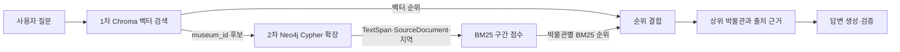

# 박물관·미술관 하이브리드 검색 BM25 구성 보고서

**작성일:** 2026-11-13

**상태:** 구현 전 설계

**대상:** `museum_final_738.csv`에서 적재한 Neo4j 지식그래프와 박물관 단위 Chroma 벡터 검색

## 목적과 결정

사용자 질문에 대한 최종 하이브리드 검색 결과를 벡터 유사도만으로 정하지 않고, 지식그래프의 출처가 연결된 본문 구간에 대한 BM25 점수도 반영한다. 검색은 **① Chroma 벡터 앵커 검색 → ② Neo4j Cypher 그래프 확장** 순서로 실행한다. BM25는 확장된 근거의 어휘 적합도를 계산하여 최종 순위를 정하는 데 사용한다. 답변에는 순위 근거가 된 `TextSpan`과 그 `SourceDocument`를 함께 전달한다.

현재 적재 보고서 기준 그래프에는 `Museum` 738개, `TextSpan` 3,260개, `SourceDocument` 1,027개가 있다. `Museum`은 `HAS_SPAN`으로 구간에, 구간은 `SUPPORTED_BY`로 출처에 연결된다. `SourceDocument`에는 원문 전체가 없으므로 BM25의 텍스트 단위는 `TextSpan.text`로 정한다. 이 수치는 2026-11-12 적재 검증 결과이며, 실행 시점의 DB 상태는 다시 확인한다. [적재 및 온톨로지 보고서](../../../src/for_build/build_neo4j/LOAD_REPORT.md)

이 보고서는 검색 구성안이다. BM25 인덱스, 순차 검색 연결, 품질 측정이 이미 구현되거나 검증됐다는 뜻은 아니다.

## 현재 코드와 연결 지점

| 구성 | 확인된 상태 | 변경 지점 |
|---|---|---|
| Chroma | `museum_id`를 문서 ID로 사용하며 `name + text` 임베딩을 검색한다. `ChromaSearchTool.search()`는 후보 수를 지정할 수 있다. | 최종 반환 수보다 많은 박물관 앵커를 가져온다. |
| 벡터 검색 서비스 | `rerank=True`는 LLM의 0/1/2 관련성 평가다. 끄면 후보 조회 수도 `top_k`로 줄어든다. | BM25 경로에서는 기존 LLM 재정렬을 끄고 `candidate_k`를 별도로 지정한다. |
| Neo4j | 적재된 `Museum → TextSpan → SourceDocument`와 `Museum → Sigungu → Sido` 경로가 있다. | 앵커 `museum_id` 목록으로 관련 구간·출처·지역을 한 번에 읽는다. |
| LangGraph | `graph.py`의 `hybrid` 경로는 벡터 검색과 그래프 검색을 각각 실행한 뒤 합친다. 실제 Neo4j 데모의 벡터 검색은 빈 결과를 반환한다. | 순차 앵커·확장·BM25 결합을 제공하는 검색 어댑터를 연결한다. |
| 의존성 | `pyproject.toml`은 Python `>=3.12,<3.13`, `neo4j`, `rank-bm25`, `kiwipiepy`를 선언한다. | 새 검색 라이브러리 없이 구현 가능하다. |

Chroma와 LangGraph 항목은 `main`의 `src/service/vertor_search_chroma.py`, `src/service/vertor_search_service.py`, `src/agent/graph.py`, `src/agent/neo4j_demo.py`를 기준으로 확인했다. 이 문서가 작성된 `feat/seventy4-neo4j` 브랜치에는 해당 검색 코드가 아직 없다. 구현 시 `main`과 통합한 코드에서 다시 확인한다.

## 검색 흐름

1. **질문 처리:** 벡터 검색에는 기존 검색 계획의 확장 검색어를 사용할 수 있다. BM25에는 원문 질문의 핵심어를 사용해 LLM 확장으로 생긴 단어가 어휘 점수를 좌우하지 않게 한다. 지역·요금·운영 정보 같은 명시 조건은 기존 필터 및 Cypher에서 처리한다.
2. **벡터 앵커:** `candidate_k = min(4 × final_k, 40)`을 초기값으로 삼는다. 예를 들어 최종 5개를 원하면 박물관 후보 최대 20개를 가져온다. 기존 LLM 관련성 평가로 후보를 먼저 잘라내지 않는다. Chroma 문서 ID와 `Museum.museum_id`의 일치 여부를 확인한다.
3. **그래프 확장:** `WHERE m.museum_id IN $museum_ids` 형태의 파라미터화된 읽기 전용 Cypher로 각 앵커의 `TextSpan`, `SourceDocument`, `Sigungu`, `Sido`를 조회한다. `span_id`와 출처 ID를 보존하며, 조인으로 같은 구간이 여러 번 반환되면 출처를 모아 구간 한 건으로 만든다. 반환 순서는 명시적으로 정한다.
4. **BM25 점수:** 모든 `TextSpan.text`를 `span_id` 순서의 코퍼스로 한 번 토큰화해 `BM25Okapi` 인덱스를 만든다. 질의에는 같은 한국어 토큰화·정규화 규칙을 적용한다. 전체 코퍼스의 문서 빈도로 계산된 점수 중 확장된 후보의 구간 점수만 사용한다. 후보마다 점수가 가장 높은 출처 연결 구간을 대표 근거로 고르고, 박물관의 BM25 점수는 그 구간의 점수로 정한다. 여러 구간의 점수를 합산해 구간 수가 많은 박물관을 부풀리지 않는다.
5. **최종 순위:** 벡터 거리와 BM25 원점수를 직접 더하지 않는다. 박물관별 벡터 순위와 **양수 BM25 점수의 순위**를 가중 Reciprocal Rank Fusion으로 합친다. 초기 설정은 `RRF 상수=60`, `벡터 가중치=1`, `BM25 가중치=1`이며 평가셋으로 조정한다. 각 검색 신호의 기여값은 `가중치 / (60 + 해당 신호 순위)`다. BM25가 0인 후보에는 BM25 기여값을 주지 않는다. 모든 후보의 BM25가 0이면 벡터 순위가 그대로 유지된다. 동점에는 벡터 순위와 `museum_id`를 차례로 적용한다. Neo4j 공식 가이드도 서로 다른 검색 점수의 직접 비교 대신 순위 기반 결합을 제시한다. [Neo4j 하이브리드 검색 가이드](https://neo4j.com/developer/genai-ecosystem/hybrid-search/)
6. **근거 반환:** 최종 결과는 `museum_id`, 박물관명, 벡터 순위, BM25 원점수·순위, 결합 점수, 대표 `span_id`, 구간 텍스트, 출처 ID·URL, 지역을 구분해 보관한다. LLM에는 출처가 연결된 실제 구간만 근거로 전달하고, 근거가 답을 뒷받침하지 않으면 답변을 보류한다.

`rank-bm25`는 코퍼스와 질의의 전처리를 자동으로 결정하지 않는다. 따라서 `kiwipiepy`로 문서와 질문에 동일한 토큰화 규칙을 적용하고, 영어 대소문자·숫자·불용어 처리 규칙을 테스트로 고정한다. [rank-bm25 사용법](https://github.com/dorianbrown/rank_bm25/blob/master/README.md?plain=1)

## 구성 요소와 책임

| 파일 또는 모듈 | 책임 |
|---|---|
| `src/agent/graph_db.py` 신규 | 읽기 전용 Cypher와 파라미터 바인딩. 앵커 ID에 따른 구간·출처 확장과 BM25 코퍼스 스냅샷 조회. 적재용 `src/for_build/build_neo4j/graph_db.py`와 역할을 분리한다. |
| `src/agent/bm25_reranker.py` 신규 | 코퍼스의 `span_id` 매핑, 한국어 토큰화, BM25 점수, 박물관 단위 최대 점수 집계, 동점 규칙. DB 접근 없음. |
| `src/agent/hybrid_search.py` 신규 | Chroma 앵커 → Cypher 확장 → BM25 평가 → 순위 결합의 순차 실행. `(question, k) -> list[Evidence]` 계약 유지. |
| `src/agent/graph.py` 수정 | `hybrid` 경로와 검증 실패 시 재검색에 새 어댑터 연결. 필요하면 순차 검색을 별도 노드로 드러낸다. |
| `src/agent/state.py` 수정 | `score`를 최종 결합 점수로 정의하고 원점수·각 순위·근거 ID를 별도 필드로 보존한다. |
| 테스트와 평가 자료 | 토큰화, 후보 제한, 다중 출처 중복 제거, 점수 결합, 근거 무결성, 실제 검색 품질을 검증한다. |

코퍼스는 애플리케이션 시작 시 Neo4j에서 읽어 메모리에 만들고 검색마다 재구축하지 않는다. 그래프 적재 내용이 바뀌면 인덱스도 다시 만든다. 실행 중 스냅샷과 Neo4j 데이터가 달라진 경우 잘못된 `span_id` 점수를 적용하지 않도록 버전·건수 또는 데이터 해시를 확인한다. Aura Free에서는 코퍼스 전체를 매 요청마다 조회하지 않는다.

## 대안 비교

| 방법 | 장점 | 이 프로젝트에서의 판단 |
|---|---|---|
| **선택: Python `rank-bm25`로 확장 근거 재정렬** | 정확히 지정한 BM25 구현과 한국어 전처리를 시험할 수 있고 Neo4j에 새 인덱스를 쓰지 않는다. | 기존 벡터 앵커 → Cypher 확장 경로에 맞는다. 코퍼스 갱신 책임은 애플리케이션이 가진다. |
| Neo4j 전문 인덱스 점수 | DB가 색인을 유지하고 별도 코퍼스 스냅샷이 필요 없다. | Neo4j 문서는 반환값을 Lucene 검색 점수로 설명한다. 한국어 분석기와 점수 동작을 별도로 검증해야 하므로 이번 BM25 명세의 기준 구현으로 삼지 않는다. [Neo4j 전문 인덱스](https://neo4j.com/docs/cypher-manual/5/indexes/semantic-indexes/full-text-indexes/) |
| 벡터·어휘 검색을 각각 전역 검색한 뒤 합치기 | 벡터 후보에서 빠진 키워드 일치 박물관도 찾을 수 있다. | 1차 벡터 앵커 후 2차 Cypher 확장이라는 현재 설계 범위를 바꾸므로 별도 개선안으로 둔다. |

## 검증 기준과 한계

- **데이터 계약:** Chroma ID와 Neo4j `museum_id`가 일치하고, 반환된 `span_id`가 해당 박물관에 연결되며 `SUPPORTED_BY` 출처가 실제로 존재해야 한다. 출처가 없는 구간은 답변 근거에서 제외한다.
- **검색 품질:** 지역·시대·주제·정확한 박물관명·복합 질문을 포함한 수작업 정답셋에서 벡터 단독 대비 `Recall@5`, `MRR@5`, `nDCG@5`, 근거 적합도를 비교한다. `candidate_k`와 RRF 가중치는 이 결과로 조정한다. 수치 개선은 측정 전까지 주장하지 않는다.
- **실패 처리:** BM25 인덱스 로딩 실패 시 경고를 남기고 벡터·그래프 근거 순위로 반환한다. Neo4j 확장 실패나 출처 부재를 정상적인 근거로 가장하지 않는다. 동점과 전부 0점, 빈 질의, 누락된 앵커 ID를 테스트한다.
- **재현성:** Python 3.12에서 고정된 토큰화 규칙, 코퍼스 버전, 후보 수, 가중치를 기록한다. 테스트는 가짜 Chroma·Neo4j로 단위 계약을 확인하고, Aura 연동 시험은 별도로 실행한다.
- **후보 한계:** BM25는 벡터 앵커에 포함되지 않은 박물관을 되찾지 못한다. 따라서 최종 품질의 상한은 1차 후보 재현율에 달려 있다. 숫자·부정 조건과 지역 필터도 BM25 점수만으로 보장되지 않는다.

## 구현 순서

1. Chroma의 `candidate_k`와 `final_k`를 분리하고 박물관 ID 계약을 검증한다.
2. 파라미터화된 Neo4j 확장 쿼리와 코퍼스 스냅샷 조회를 구현한다.
3. 한국어 토큰화·BM25 점수·박물관별 대표 근거 선택을 구현한다.
4. 벡터와 BM25의 순위를 결합해 LangGraph 결과 계약에 연결한다.
5. 단위 테스트와 실제 Aura·Chroma 읽기 시험을 통과시킨 뒤 검색 품질을 평가하고 가중치를 확정한다.
