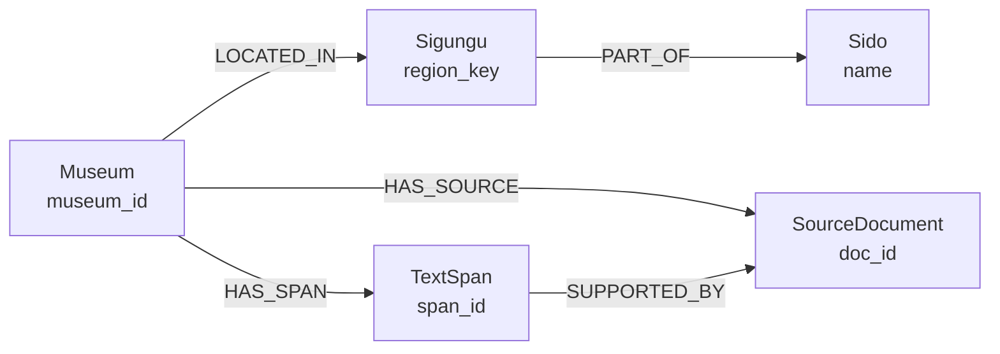

# Neo4j 박물관 그래프 적재 보고서와 DB 명세

이 문서는 2026-11-12 적재 결과와 2026-11-13 15:35:50 KST에 Aura DB를 **읽기 전용으로 조회한 온톨로지 스냅샷**을 함께 기록한다. 노드·관계·속성·제약조건의 현재 수치는 후자 기준이며, 적재 당시 실행 환경과 데이터 품질 수치는 별도로 표시한다. 노드·관계·속성·제약조건의 기계 판독 스냅샷은 저장소 상위 `프로젝트/Neo4j_온톨로지.json`에 있다. 인덱스는 같은 날 추가로 조회해 아래 DB 명세에 기록했다.

## 적재 이력

**실행일:** 2026-11-12 (KST)  
**입력:** `src/for_build/museum_final_738.csv`  
**입력 SHA-256:** `c40d1f2d794bfd6415c763fe487d639a634c0cba9313984ec4b0b67a4ea6cb45`  
**환경:** Python 3.12.13, Neo4j Python Driver 6.4.1, 대상 DB `878d9ed6`  
**당시 상태:** 적재 후 Neo4j에서 읽은 수가 입력 기준과 일치함. 동일 CSV를 재실행한 뒤에도 수가 유지됨.

| 대상 | CSV에서 예상 | Neo4j 읽기 결과 |
|---|---:|---:|
| 박물관 `Museum` | 738 | 738 |
| 출처 `SourceDocument` | 1,027 | 1,027 |
| 본문 구간 `TextSpan` | 3,260 | 3,260 |
| `Museum`–`SourceDocument` | 1,027 | 1,027 |
| `Museum`–`TextSpan` | 3,260 | 3,260 |
| `TextSpan`–`SourceDocument` | 3,270 | 3,270 |
| 시도 `Sido` | 20 | 20 |
| 시군구 `Sigungu` (시도+시군구 조합) | 199 | 199 |
| `Museum`–`Sigungu` | 738 | 738 |
| `Sigungu`–`Sido` | 199 | 199 |

적재는 박물관 50개씩 15개 트랜잭션으로 실행했다. 당시 입력 전체의 ID 중복, JSON 구조, 본문 길이·SHA-256, 좌표, 근거 구간과 출처 참조를 쓰기 전에 검증했고 Python 3.12 테스트 10개가 통과했다. 당시의 기계 판독 결과는 `load_result.json`에 있다. 2026-11-13 스냅샷에서도 위 CSV의 ID 범위에 대한 기본 건수·다중 홉 검증이 통과했다. 이 검증은 CSV에 없는 과거 데이터의 부재까지 증명하지는 않는다.

## 현재 DB 온톨로지

2026-11-13 15:35:50 KST의 **DB 전체** 조회에서 노드 라벨 5종, 노드 5,244개, 관계 패턴 5종, 관계 8,494개를 확인했다. 별도 전체 건수 조회에서도 노드 5,244개·관계 8,494개였으며 다중 라벨 노드는 0개였다. 아래 온톨로지는 그때 실제로 존재한 노드와 관계만 나타낸다. 관계의 의미는 `graph_db.py`의 적재 쿼리와 입력 구조를 기준으로 설명한다.

| 노드 라벨 | 관측 수 | 적재기 식별 키 | 의미 |
|---|---:|---|---|
| `Museum` | 738 | `museum_id` | 박물관·미술관 기본 정보와 통합 설명 본문 |
| `Sigungu` | 199 | `region_key` | 시도·시군구 조합으로 구별한 행정구역 |
| `Sido` | 20 | `name` | 시도 행정구역 |
| `SourceDocument` | 1,027 | `doc_id` | 설명에 사용된 출처의 메타데이터 |
| `TextSpan` | 3,260 | `span_id` | 통합 설명 본문에서 출처로 추적할 수 있는 구간 |

| 관계 방향과 유형 | 관측 수 | 관계 속성 | 의미 |
|---|---:|---|---|
| `Museum` → `Sigungu` `LOCATED_IN` | 738 | 없음 | 박물관이 위치한 시군구 |
| `Sigungu` → `Sido` `PART_OF` | 199 | 없음 | 시군구가 속한 시도 |
| `Museum` → `SourceDocument` `HAS_SOURCE` | 1,027 | 없음 | 박물관 설명에 사용된 출처 |
| `Museum` → `TextSpan` `HAS_SPAN` | 3,260 | 없음 | 박물관 설명의 근거 구간 |
| `TextSpan` → `SourceDocument` `SUPPORTED_BY` | 3,270 | 없음 | 구간을 뒷받침하는 출처. 한 구간에 복수 출처 가능 |

`TextSpan`은 독립 문서가 아니라 `Museum.text`의 부분 문자열이다. `SUPPORTED_BY`도 **해당 설명 구간의 출처**를 뜻하며 요금·운영시간 등 박물관의 모든 속성이 독립 검증됐다는 뜻은 아니다. 박물관 간 유사성, 전시 주제, 인물·사건 관계는 이 적재 모델에 없다. 관계별 개수는 관측 결과이며 1:1 또는 1:N 카디널리티를 강제하는 DB 제약은 없다.

## DB 명세

### 데이터베이스와 식별 키

| 항목 | 값 또는 규칙 |
|---|---|
| 대상 데이터베이스 | `878d9ed6` |
| 모델 | Neo4j 속성 그래프; 노드 라벨 5종과 방향성 관계 유형 5종 관측 |
| 기준 시각 | 2026-11-13 15:35:50 KST의 읽기 전용 조회 |
| `Museum` 식별 | CSV의 `museum_id` |
| `SourceDocument` 식별 | 출처 JSON의 `doc_id` |
| `TextSpan` 식별 | `museum_id:구간순번` 형식의 `span_id`; 구간 순서가 바뀌면 같은 ID의 의미도 바뀔 수 있음 |
| `Sigungu` 식별 | `[sido, sigungu]` 배열을 JSON 문자열로 직렬화한 `region_key` |
| `Sido` 식별 | `name` |

### 실제 제약조건

| 제약조건 이름 | 라벨 | 속성 | 유형 |
|---|---|---|---|
| `museum_id_unique` | `Museum` | `museum_id` | 노드 속성 유일성 |
| `source_doc_id_unique` | `SourceDocument` | `doc_id` | 노드 속성 유일성 |
| `span_id_unique` | `TextSpan` | `span_id` | 노드 속성 유일성 |
| `sido_name_unique` | `Sido` | `name` | 노드 속성 유일성 |
| `sigungu_key_unique` | `Sigungu` | `region_key` | 노드 속성 유일성 |
| `museumkg_entity_id` | `Entity` | `id` | 노드 속성 유일성 |

앞의 다섯 제약은 현재 적재기에서 정의한다. `Entity.id` 제약은 DB에 존재하지만 조회 시점에 `Entity` 라벨 노드는 **0개**였다. 따라서 `Entity`는 위의 관측된 온톨로지 노드에 포함하지 않았다. 제약조건은 식별 키의 유일성만 보장하며 속성 필수 입력이나 관계 수를 보장하지 않는다.

### 실제 인덱스

2026-11-13 추가 읽기 조회에서 인덱스 9개를 확인했다. 유일성 제약 6개에는 같은 이름의 RANGE 인덱스가 연결되어 있고, `museumkg_name`은 별도 RANGE 인덱스다.

| 인덱스 이름 | 유형 | 대상 | 소유 제약 |
|---|---|---|---|
| `index_460996c0` | LOOKUP | 노드 라벨 | 없음 |
| `index_1b9dcc97` | LOOKUP | 관계 유형 | 없음 |
| `museum_id_unique` | RANGE | `Museum.museum_id` | `museum_id_unique` |
| `source_doc_id_unique` | RANGE | `SourceDocument.doc_id` | `source_doc_id_unique` |
| `span_id_unique` | RANGE | `TextSpan.span_id` | `span_id_unique` |
| `sido_name_unique` | RANGE | `Sido.name` | `sido_name_unique` |
| `sigungu_key_unique` | RANGE | `Sigungu.region_key` | `sigungu_key_unique` |
| `museumkg_entity_id` | RANGE | `Entity.id` | `museumkg_entity_id` |
| `museumkg_name` | RANGE | `Museum.name` | 없음 |

이 조회에서 Neo4j `VECTOR` 인덱스는 관측되지 않았다. 이 결과는 Neo4j 내부 인덱스에 한정되며 별도 벡터 DB의 상태를 나타내지 않는다.

### 관측된 노드 속성

아래 자료형은 적재 코드의 희망 타입이 아니라 **조회 시점 실제 저장값의 타입**이다. `존재/전체`는 해당 라벨 노드 중 속성이 저장된 수를 뜻한다. 값이 없는 CSV 칸은 Neo4j에 속성으로 남지 않을 수 있다. 속성마다 제약이 따로 있는 것은 아니며 유일성 제약은 위 표의 다섯 관측 노드 키에만 적용된다.

#### Museum: 738개

| 분류 | 속성 | 자료형 | 존재/전체 |
|---|---|---|---:|
| 식별·위치 | `museum_id` | STRING | 738/738 |
| 식별·위치 | `name` | STRING | 738/738 |
| 식별·위치 | `address` | STRING | 738/738 |
| 식별·위치 | `sido` | STRING | 738/738 |
| 식별·위치 | `sigungu` | STRING | 738/738 |
| 식별·위치 | `latitude` | FLOAT | 738/738 |
| 식별·위치 | `longitude` | FLOAT | 738/738 |
| 운영 주체 | `manager_name` | STRING | 737/738 |
| 운영 주체 | `operator_name` | STRING | 738/738 |
| 운영 주체 | `ownership_type` | STRING | 738/738 |
| 운영 주체 | `provider_name` | STRING | 738/738 |
| 운영 주체 | `homepage_url` | STRING | 679/738 |
| 운영·요금 | `weekday_open` | STRING | 738/738 |
| 운영·요금 | `weekday_close` | STRING | 738/738 |
| 운영·요금 | `holiday_open` | STRING | 733/738 |
| 운영·요금 | `holiday_close` | STRING | 733/738 |
| 운영·요금 | `closure_rule_raw` | STRING | 738/738 |
| 운영·요금 | `adult_fee` | INTEGER | 738/738 |
| 운영·요금 | `youth_fee` | INTEGER | 738/738 |
| 운영·요금 | `child_fee` | INTEGER | 738/738 |
| 운영·요금 | `adult_fee_status` | STRING | 738/738 |
| 운영·요금 | `fee_notes` | STRING | 376/738 |
| 안내 | `amenities_raw` | STRING | 343/738 |
| 안내 | `transport_notes` | STRING | 376/738 |
| 안내 | `visit_notice` | STRING | 6/738 |
| 본문·출처 | `text` | STRING | 738/738 |
| 본문·출처 | `text_length` | INTEGER | 738/738 |
| 본문·출처 | `text_sha256` | STRING | 738/738 |
| 본문·출처 | `source_doc_count` | INTEGER | 738/738 |
| 본문·출처 | `source_documents_json` | STRING | 738/738 |
| 본문·출처 | `text_spans_json` | STRING | 738/738 |
| 본문·출처 | `source_types` | STRING | 738/738 |
| 중복·검토 | `duplicate_source_rows` | STRING | 738/738 |
| 중복·검토 | `removed_duplicate_sentence_count` | INTEGER | 738/738 |
| 중복·검토 | `requires_manual_review` | BOOLEAN | 738/738 |
| 중복·검토 | `qa_flags` | STRING | 657/738 |
| 중복·검토 | `duplicate_data_conflict` | STRING | 23/738 |
| 중복·검토 | `merge_review_flags` | STRING | 7/738 |
| 검증 이력 | `base_data_date` | STRING | 738/738 |
| 검증 이력 | `official_verified_at` | STRING | 26/738 |
| 검증 이력 | `official_verified_field_count` | INTEGER | 697/738 |
| 관광·이미지 | `tour_contentid` | STRING | 493/738 |
| 관광·이미지 | `tour_match_status` | STRING | 738/738 |
| 관광·이미지 | `tour_modified_at` | STRING | 493/738 |
| 관광·이미지 | `image_url` | STRING | 467/738 |
| 관광·이미지 | `image_copyright` | STRING | 467/738 |

`source_documents_json`과 `text_spans_json`은 `Museum`에 **문자열**로 남아 있고, 동시에 각각 `SourceDocument` 노드 및 `TextSpan`·`SUPPORTED_BY` 관계로 구조화되어 있다. `adult_fee=0`을 확인된 무료 입장으로 단정하지 않는다.

#### Sido와 Sigungu

| 라벨 | 속성 | 자료형 | 존재/전체 | 용도 |
|---|---|---|---:|---|
| `Sido` | `name` | STRING | 20/20 | 시도 이름과 유일 키 |
| `Sigungu` | `region_key` | STRING | 199/199 | 시도·시군구 조합의 유일 키 |
| `Sigungu` | `name` | STRING | 199/199 | 시군구 이름 |
| `Sigungu` | `sido` | STRING | 199/199 | 연결된 시도 이름 |

#### SourceDocument: 1,027개

| 속성 | 자료형 | 존재/전체 |
|---|---|---:|
| `doc_id` | STRING | 1,027/1,027 |
| `source_type` | STRING | 1,027/1,027 |
| `source_file` | STRING | 1,027/1,027 |
| `source_locator` | STRING | 1,027/1,027 |
| `source_record_id` | STRING | 1,027/1,027 |
| `source_row` | STRING | 1,005/1,027 |
| `source_url` | STRING | 22/1,027 |
| `museum_homepage_url` | STRING | 944/1,027 |
| `original_museum_id` | STRING | 1,027/1,027 |
| `base_row_id` | STRING | 1,027/1,027 |
| `match_trust` | STRING | 1,027/1,027 |
| `text_length` | STRING | 1,027/1,027 |
| `text_sha256` | STRING | 1,027/1,027 |
| `original_representative_description_json` | STRING | 738/1,027 |

`SourceDocument`는 출처 메타데이터 노드다. `original_representative_description_json`은 JSON을 직렬화한 문자열이며, `SourceDocument.text_length`도 현재 DB에서는 `Museum.text_length`와 달리 STRING이다. `source_file`·`source_locator`는 원본을 가리키는 메타데이터이고 원문 전체가 이 노드의 별도 본문 속성으로 저장된 것은 아니다.

#### TextSpan: 3,260개

| 속성 | 자료형 | 존재/전체 | 용도 |
|---|---|---:|---|
| `span_id` | STRING | 3,260/3,260 | 박물관 ID와 구간 순번을 결합한 유일 키 |
| `start` | INTEGER | 3,260/3,260 | `Museum.text`의 시작 인덱스, 포함 |
| `end` | INTEGER | 3,260/3,260 | 종료 인덱스, 미포함 |
| `text` | STRING | 3,260/3,260 | `Museum.text[start:end]` 부분 문자열 |

`TextSpan`의 출처 ID 목록은 노드 속성이 아니라 `SUPPORTED_BY` 관계로 표현된다. 이 관계는 3,270개로 구간 수보다 10개 많다. 속성이나 출처 연결을 바꿔 재적재할 때는 `MERGE`가 이전 노드·관계를 자동 삭제하지 않는다는 점을 고려해야 한다.

## Multi-hop 경로 검증

**최초 검증:** 2026-11-12 11:54:20 KST. **현재 스냅샷 재검증:** 2026-11-13 15:35:50 KST.

**방식:** `validate_multihop.py`와 동일한 `GraphStore.verify_multihop` 로직으로 Aura DB를 읽기 전용 조회했다. `museum_final_738.csv`의 박물관·출처·구간 ID 집합으로 범위를 제한하고 아래 경로 수를 대조했다. 최초 실행 결과는 `multihop_result.json`, 현재 재검증 결과는 상위 폴더의 `Neo4j_온톨로지.json`에 기록되어 있다.

| 검사 경로·조건 | CSV 기준 기대 | 현재 DB 결과 |
|---|---:|---:|
| 2홉 `Museum → Sigungu → Sido` 경로; 박물관의 시도·시군구 속성과 일치 | 738 | 738 |
| 위 2홉 경로에 도달한 고유 박물관 | 738 | 738 |
| 2홉 `Museum → TextSpan → SourceDocument`; 동일 박물관의 `HAS_SOURCE` 출처인지 확인 | 3,270 | 3,270 |
| 3홉 `Sido ← Sigungu ← Museum → SourceDocument` | 1,027 | 1,027 |
| 4홉 `Sido ← Sigungu ← Museum → TextSpan → SourceDocument`; 동일 박물관의 출처인지 확인 | 3,270 | 3,270 |
| `TextSpan.text`와 `Museum.text[start:end]`가 다른 구간 | 0 | 0 |

**판정:** 참조 CSV의 ID 범위에서 지역 및 텍스트 출처 경로는 구조적으로 일치한다. 이는 다중 홉 연결과 근거 위치를 검증한 결과이며, 출처 원문의 사실 정확성이나 LLM 답변 품질, DB에 남은 다른 ID의 부재를 증명하지 않는다. 이 그래프는 GraphRAG의 2차 Cypher 확장에 사용할 수 있는 구조이며, 1차 벡터 앵커 검색의 구현·품질 검증은 별도 범위다.

## 데이터 해석과 재적재 시 주의사항

- 2026-11-12 입력 CSV에서는 655개 박물관의 `requires_manual_review=True`, `adult_fee=0`인 428개 행의 `adult_fee_status=BASE_FEE_ZERO_CHECK_EXCEPTIONS`가 확인됐다. 0원만으로 확인된 무료 입장이라고 안내하지 않는다. 이 품질 집계는 당시 입력 기준이며 이번 온톨로지 스냅샷의 속성값 재집계는 아니다.
- 출처 메타데이터와 본문 구간의 연결이 구조적으로 검증됐더라도 출처 원문의 사실 정확성을 보증하지 않는다. `SourceDocument`의 `source_file`과 `source_locator`를 이용한 원문 대조는 별도 작업이다.
- 현재 노드 속성 목록에는 임베딩 속성이 관측되지 않았다. 별도 벡터 DB 또는 BM25 검색 데이터는 이 Neo4j DB 명세에 포함되지 않는다.
- 적재기는 `MERGE`로 기존 ID를 갱신하거나 새 ID를 추가하지만 새 CSV에서 빠진 노드·이전 관계를 자동 삭제하지 않는다. 삭제·ID·지역·출처 연결이 바뀌면 별도 정리 또는 재구축이 필요하다. 상세 실행 순서는 상위 폴더의 `Neo4j_재적재_운영_가이드.md`에 있다.
- 최초 적재 전에 같은 ID가 이미 몇 개 있었는지는 기록하지 않았으므로 최초 보고서의 수치를 모두 새로 생성한 수로 해석할 수 없다. 현재 표의 수치는 2026-11-13 조회 시점에 실제 존재한 수다.
