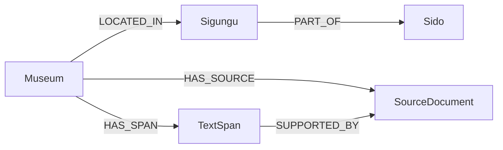

# 박물관 CSV → Neo4j 적재

입력: `src/for_build/museum_final_738.csv` (UTF-8, 738행). Python 3.12를 사용합니다. 필요한 패키지는 루트 `pyproject.toml`/`uv.lock`과 이 폴더의 `requirements.txt`에 명시했습니다.

## 설치와 실행

저장소 루트에서 PowerShell로 실행합니다.

```powershell
$env:UV_CACHE_DIR = Join-Path $env:TEMP 'uv-cache-museum'
uv venv --python 3.12 .venv
uv pip install --python .venv/Scripts/python.exe -r src/for_build/build_neo4j/requirements.txt
& .venv/Scripts/python.exe src/for_build/build_neo4j/load_neo4j.py --dry-run
& .venv/Scripts/python.exe src/for_build/build_neo4j/load_neo4j.py
& .venv/Scripts/python.exe src/for_build/build_neo4j/load_neo4j.py --verify-only
```

루트 `.env`에 `NEO4J_URI`, `NEO4J_USER`, `NEO4J_PASSWORD`, `NEO4J_DATABASE`가 필요합니다. `--dry-run`은 DB에 연결하지 않습니다. 본 적재 명령은 연결 확인 후 유일성 제약을 만들고 50개 박물관씩 트랜잭션으로 적재합니다. 실패 시 종료 코드 1을 반환하며 성공 보고서를 새로 쓰지 않습니다. 성공 시 이 폴더의 `load_result.json`에 DB 읽기 검증 결과를 기록합니다. `--verify-only`는 DB를 수정하지 않고 같은 ID 집합을 읽어 수를 확인합니다.

테스트: `& .venv/Scripts/python.exe -m unittest discover -s src/for_build/build_neo4j -p 'test_*.py' -v`

## 적재 스키마



- `Museum.museum_id`, `SourceDocument.doc_id`, `TextSpan.span_id`, `Sido.name`, `Sigungu.region_key`에 유일성 제약을 둡니다.
- CSV 열은 `Museum` 속성에 보존합니다. 빈 값은 Neo4j의 없는 속성으로 처리하고, 요금·좌표·검토 여부·길이 등은 해당 숫자/불리언 타입으로 변환합니다.
- 출처 JSON의 객체 필드는 JSON 문자열 속성으로 보존합니다. 각 `TextSpan.text`는 박물관 본문의 `[start:end]`이며, 출처 문서와 관계로 연결합니다.
- `MERGE`를 사용해 동일 파일 재실행 시 중복 생성을 막습니다. 이 명령은 CSV에서 제거된 과거 ID를 자동 삭제하는 전체 동기화 도구는 아닙니다.

벡터 임베딩은 이 CSV에 없습니다. 별도 벡터 작업에서 `Museum` 또는 `TextSpan` 본문에 임베딩을 만들 때 모델과 차원을 확정해야 합니다. GraphRAG 질의는 **1차 벡터 앵커 검색 → 2차 이 그래프의 Cypher 확장** 순서를 사용해야 합니다. 요금 `0`은 검증된 무료와 동일하게 해석하지 않습니다.
