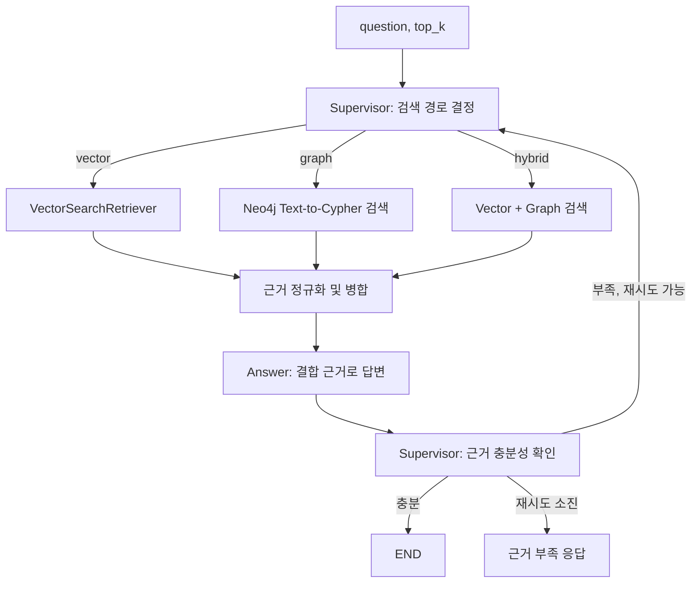

# LangGraph Vector + Neo4j 하이브리드 연동 가이드

이 문서는 `VectorSearchRetriever`와 Neo4j Graph 검색을 하나의 LangGraph 흐름에 연결하는 팀 공유용 예시입니다. 검색기는 근거만 반환하고, Supervisor가 검색 경로와 재검색을 결정하며, Answer 노드가 두 검색기의 근거를 사용해 답변을 만듭니다.

> 이 문서는 연동 설계 예시입니다. 현재 저장소의 실제 Neo4j 데모와 Ragas 평가는 Graph 검색만 연결되어 있습니다. `src/agent/graph.py`에는 일반 vector/graph/hybrid 라우팅이 있지만, `VectorSearchRetriever`를 호출하는 어댑터와 아래 진단 State 필드는 아직 연결되어 있지 않습니다.

## 현재 구성요소

| 구성요소 | 현재 인터페이스 | 반환 내용 |
|---|---|---|
| Vector 검색 | [`VectorSearchRetriever.retrieve(query, top_k)`](../src/service/vector_search_rag_agent.py) | `results`, `source_ids`, `status`, `warnings`, `unsupported_constraints`, `search_summary`가 든 딕셔너리 |
| Graph 검색 | [`Neo4jText2Cypher.search(question, k)`](../src/agent/neo4j_text2cypher.py) | `list[Evidence]` |
| LangGraph 조립 | [`build_graph(vector_search, graph_search, route_question, ...)`](../src/agent/graph.py) | vector/graph/hybrid 경로, 답변 검증, 실패 시 hybrid 재검색 |

Vector 검색 결과 한 건은 `document`와 `metadata`를 사용합니다. Graph 검색 결과는 이미 `text`, `span_id`, 출처 ID, 지역 필드를 가진 `Evidence`입니다. 따라서 Vector 노드에서 결과를 공통 `Evidence` 형태로 변환해야 두 검색 결과를 같은 Answer 노드에 전달할 수 있습니다.

## 권장 흐름



Supervisor의 첫 라우팅 예시는 다음과 같습니다.

| 질문 유형 | 경로 |
|---|---|
| 전시 주제, 유물, 체험처럼 설명의 의미를 찾는 질문 | `vector` |
| 박물관 간 관계나 그래프 관계를 확인하는 질문 | `graph` |
| 주제 검색과 관계 확인을 함께 해야 하거나 한쪽 검색만으로 근거가 부족한 질문 | `hybrid` |

검색 실패나 검증 실패 시 재검색 여부도 Supervisor가 결정합니다. 단순히 Vector 결과가 `partial`인 것만으로 답변을 실패 처리하지 말고, 진단 정보와 Graph 근거를 함께 확인합니다.

## State 예시

검색기가 State를 직접 요구하는 것은 아닙니다. 상위 LangGraph가 검색 결과와 진단 정보를 보존하기 위해 아래 필드를 둘 수 있습니다.

```python
from typing import Any, Literal, TypedDict


class HybridState(TypedDict, total=False):
    question: str
    top_k: int
    route: Literal["vector", "graph", "hybrid"]

    vector_evidence: list[dict[str, Any]]
    vector_source_ids: list[str]
    vector_search_status: Literal["ok", "partial", "no_results"]
    vector_search_diagnostics: dict[str, Any]

    graph_evidence: list[dict[str, Any]]
    evidence: list[dict[str, Any]]  # Answer 노드가 읽는 최종 근거
    answer: str
    verified: bool
    retry_count: int
    failure_reason: str
```

`top_k`는 최종 Answer 노드에 전달할 근거 수로 해석합니다. Hybrid에서는 각 검색기에서 최대 `top_k` 후보를 받은 다음, 중복을 정리하고 마지막에 다시 `top_k`개로 제한합니다.

## Vector 검색 노드

```python
from src.service.vector_search_rag_agent import VectorSearchRetriever

vector_retriever = VectorSearchRetriever()


def vector_search_node(state: HybridState) -> dict:
    result = vector_retriever.retrieve(
        query=state["question"],
        top_k=state.get("top_k", 5),
    )

    evidence = []
    for hit in result["results"]:
        metadata = hit.get("metadata") or {}
        evidence.append({
            **hit,
            "museum_id": str(hit["museum_id"]),
            "name": hit.get("name") or metadata.get("name", ""),
            "text": str(hit.get("document") or ""),
            "metadata": metadata,
            "source_doc_ids": metadata.get("source_doc_ids", []),
            "sido": metadata.get("sido", ""),
            "sigungu": metadata.get("sigungu", ""),
            "retriever": "vector",
        })

    return {
        "vector_evidence": evidence,
        "vector_source_ids": result["source_ids"],
        "vector_search_status": result["status"],
        "vector_search_diagnostics": {
            **result["search_summary"],
            "warnings": result["warnings"],
            "unsupported_constraints": result["unsupported_constraints"],
        },
    }
```

Vector 단독 경로에서는 위 결과를 `evidence`에도 넣습니다. Hybrid 경로에서는 Vector 진단 필드를 보존한 채 Graph 근거와 합칩니다.

## Graph 노드와 Hybrid 병합

Graph 노드는 기존 검색기를 호출해 `graph_evidence`를 반환합니다.

```python
def graph_search_node(state: HybridState) -> dict:
    evidence = graph_retriever.search(
        state["question"],
        k=state.get("top_k", 5),
    )
    return {"graph_evidence": evidence}
```

아래는 두 목록을 출처별 순위 순서대로 번갈아 살펴 최종 개수만 반환하는 간단한 병합 예입니다. 같은 박물관이라도 근거 문장이나 span이 다르면 별도 근거로 유지합니다.

```python
def _evidence_key(item: dict) -> tuple[str, str, str]:
    text = " ".join(str(item.get("text", "")).split()).casefold()
    return (
        str(item.get("museum_id", "")),
        str(item.get("span_id") or item.get("chunk_id") or ""),
        text,
    )


def _as_list(value) -> list:
    if value is None:
        return []
    if isinstance(value, str):
        return [value] if value else []
    return list(value)


def merge_evidence(vector: list[dict], graph: list[dict], *, top_k: int) -> list[dict]:
    merged: dict[tuple[str, str, str], dict] = {}
    order: list[tuple[str, str, str]] = []

    for rank in range(max(len(vector), len(graph))):
        for source, rows in (("vector", vector), ("graph", graph)):
            if rank >= len(rows):
                continue
            item = dict(rows[rank])
            key = _evidence_key(item)
            if key not in merged:
                item["retriever"] = source
                item["retrievers"] = [source]
                merged[key] = item
                order.append(key)
                continue

            existing = merged[key]
            labels = list(dict.fromkeys([*existing.get("retrievers", []), source]))
            existing["retrievers"] = labels
            existing["retriever"] = "hybrid" if len(labels) > 1 else labels[0]
            for field in ("source_doc_ids", "source_urls"):
                values = [
                    *_as_list(existing.get(field)),
                    *_as_list(item.get(field)),
                ]
                existing[field] = list(dict.fromkeys(values))

    return [merged[key] for key in order[:top_k]]
```

Hybrid 노드는 두 검색기를 호출하고, 공통 근거 목록을 만듭니다.

```python
def hybrid_search_node(state: HybridState) -> dict:
    vector_state = vector_search_node(state)
    graph_state = graph_search_node(state)

    evidence = merge_evidence(
        vector_state["vector_evidence"],
        graph_state["graph_evidence"],
        top_k=state.get("top_k", 5),
    )
    return {
        **vector_state,
        **graph_state,
        "evidence": evidence,
    }
```

예시 병합은 점수 자체를 비교하지 않고 Vector와 Graph 결과 순위를 번갈아 살펴 최종 `top_k`개를 고릅니다. 같은 근거가 두 검색기에 잡히면 `retriever="hybrid"`와 `retrievers=["vector", "graph"]`를 보존합니다. 박물관 ID만으로 합치면 서로 다른 근거 문장이 사라질 수 있으니 주의합니다.

Vector `relevance`와 Neo4j 결과 순서는 같은 점수 척도가 아닙니다. 단순히 숫자 점수를 더하지 말고, 처음에는 순위를 유지하는 병합 정책을 사용합니다. Graph 검색도 신뢰할 수 있는 관련도 순위를 반환하게 되면 그때 RRF 같은 순위 기반 융합을 비교할 수 있습니다.

## Supervisor와 답변 연결

기존 `build_graph()`를 재사용한다면:

1. `vector_search` 어댑터는 `retrieve()` 반환값 중 근거 리스트를 공통 `Evidence`로 변환합니다.
2. `graph_search`는 `Neo4jText2Cypher.search`를 연결합니다.
3. `route_question`은 `vector`, `graph`, `hybrid` 중 하나를 반환합니다.
4. Hybrid 노드는 Vector 진단 State와 Graph 근거, 최종 병합 근거를 모두 반환합니다.
5. Answer 노드는 `evidence`만 사용합니다. 검증 실패 후 재검색 여부는 Supervisor가 판단합니다.

현재 `src/agent/graph.py`의 일반 Hybrid 노드는 두 검색 함수를 순서대로 호출하고 동일 근거를 합치지만, Vector 서비스의 `status`·진단 정보를 State에 저장하지 않으며 병합 결과의 최종 `top_k` 제한도 하지 않습니다. 위 State 필드와 진단 보존이 필요하면 `src/agent/state.py`와 해당 노드 반환값을 함께 확장해야 합니다.

## 운영 및 확인 항목

- `.env`에 OpenAI와 Neo4j 설정을 둡니다. 비밀값은 GitHub에 올리지 않습니다.
- Vector 경로는 `data/vector_db/museum_chroma`의 `museum_documents` 컬렉션이 있어야 동작합니다. ChromaDB 파일은 생성 데이터이므로 저장소에 추가하지 않습니다.
- Vector 상태가 `no_results`여도 Graph에 근거가 있으면 Hybrid 답변을 계속 구성할 수 있습니다.
- `partial`은 미지원 조건이나 경고가 있다는 뜻입니다. 해당 내용을 `vector_search_diagnostics`에 남기고 Supervisor가 답변 가능 여부를 판단합니다.
- `verified`는 실제 인용·사실 검증 로직을 연결해야 의미가 있습니다. 현재 Neo4j smoke 경로의 검증기는 답변에 박물관 ID가 남았는지만 확인합니다.
- Ragas를 Hybrid 평가에 쓰려면 `ragas_eval.py`가 Graph 단독이 아닌 Hybrid 그래프를 호출하도록 별도로 연결해야 합니다. 현재 평가 코드는 Graph 경로만 사용합니다.
